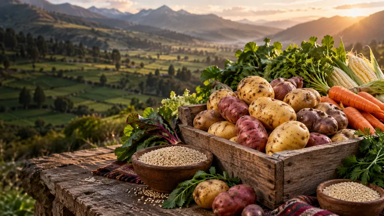
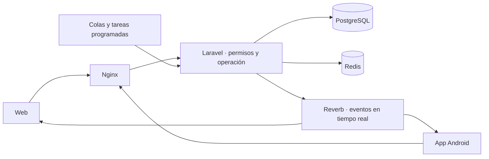

<div align="center">

<a id="agrolazo"></a>

# 🌱 AgroLazo

### El campo nos une

**Del productor a tu negocio, con origen, coordinación y trazabilidad.**

<p>
  <a href="https://weights-hierarchy-delays-gathered.trycloudflare.com/downloads/AgroLazo-1.3.3.apk">
    
  </a>
</p>

**[Descargar la app Android 1.3.3 →](https://weights-hierarchy-delays-gathered.trycloudflare.com/downloads/AgroLazo-1.3.3.apk)**

Android 8.0 o superior · Web y app conectadas al mismo sistema

> **Descarga desde un servidor temporal.** Este enlace requiere que la laptop y su túnel estén activos. No respondió en la comprobación del 22/10/2026. Al reiniciar, Cloudflare puede asignar otra dirección: utiliza la URL y el APK que indique el script de encendido. El archivo todavía no está publicado en GitHub Releases.

<p>
  
  
  
  
  
</p>

**[La plataforma](#la-plataforma) · [Perfiles](#cuatro-perfiles-un-mismo-sistema) · [Flujo](#del-campo-a-la-entrega) · [Instalación](#instalación) · [Documentación](#documentación)**



<sub>Imagen referencial de la identidad visual de AgroLazo.</sub>

</div>

---

## La plataforma

**AgroLazo conecta a pequeños productores agrícolas con compradores finales**, como restaurantes, hoteles, negocios y hogares. Nace con enfoque en Puno, Perú, y reúne el recorrido comercial en una misma plataforma: publicar producción, reunir aportaciones cercanas, comprar, coordinar el acopio y seguir la entrega.

La web y la app Android comparten cuentas, datos y permisos. Productores y compradores pueden registrarse por su cuenta; el equipo revisa sus perfiles y acompaña las operaciones desde sus paneles.

| 🌾 Producción con contexto | 🛒 Compras claras | 💬 Coordinación integrada |
| :--- | :--- | :--- |
| Productos, variedades, cantidades, ubicación y disponibilidad de cada productor. | Catálogo visual, filtros, compras parciales y desglose antes de confirmar. | Conversaciones, avisos y seguimiento dentro de AgroLazo. |

**Idioma:** español · **Moneda:** soles peruanos, PEN · **Horario operativo:** America/Lima

## Cuatro perfiles, un mismo sistema

| Perfil | Qué puede hacer |
| :--- | :--- |
| **Productor** | Crear su cuenta, completar su ficha y ubicación, registrar varios cultivos, enviar ofertas con fotografías, aceptar precios y consultar ventas, recojos y liquidaciones. |
| **Comprador** | Explorar lotes, guardar su destino habitual, cotizar cantidades, elegir fecha de entrega, confirmar compras, adjuntar comprobantes y seguir sus pedidos. Las compras requieren un perfil aprobado. |
| **Coordinador** | Revisar productores y ofertas, proponer condiciones, consultar aportaciones y mapas, conversar con los usuarios y organizar acopio, pesaje y entregas según sus permisos. |
| **Administrador** | Gestionar usuarios, accesos, catálogos y configuración; supervisar lotes, operaciones, cobros, liquidaciones, reportes y auditoría. |

Cada usuario consulta la información que corresponde a su rol. Los controles se aplican también en el servidor.

## Del campo a la entrega

1. **Registro y ubicación.** El productor completa su ficha, indica qué produce y marca su ubicación. El comprador puede guardar su dirección habitual y ajustar el destino en cada pedido.
2. **Oferta y revisión.** El productor registra producto, variedad, calidad, cantidad, disponibilidad y fotos. Coordinación verifica los datos y prepara la propuesta económica, usando una referencia de mercado válida o revisión manual.
3. **Aceptación y publicación.** El productor confirma las condiciones. El sistema publica y agrupa las aportaciones compatibles cuando cumplen los requisitos, conservando el origen y la cantidad de cada participante.
4. **Exploración y cotización.** El comprador filtra el catálogo y elige cuánto necesita. La compra mínima predeterminada es **25 kg**, configurable. La cotización muestra los importes y **no reserva inventario por sí sola**.
5. **Confirmación del pedido.** El comprador revisa las condiciones, la dirección exacta y la fecha solicitada de entrega. La confirmación compromete las cantidades e informa a los productores cuyas aportaciones se utilizarán.
6. **Acopio y recepción.** El equipo programa los recojos, comunica las instrucciones y registra el peso recibido, aceptado o rechazado. El transporte lo organiza y cubre AgroLazo; la fecha de recojo se coordina por separado de la entrega solicitada.
7. **Cobro, despacho y entrega.** El comprador registra un pago a AgroLazo y adjunta su comprobante. El equipo verifica el ingreso y gestiona el despacho, la entrega y las posibles incidencias.
8. **Liquidación y cierre.** Se calcula el importe de cada productor según las cantidades aceptadas y su acuerdo. Administración registra el desembolso y concilia la operación, conservando su historial.

> **Pagos con respaldo real:** una captura de Yape u otro comprobante es evidencia para revisar, no una confirmación bancaria automática. El sistema registra cobros y desembolsos; no transfiere dinero por sí solo.

## Lo que incluye

| Módulo | Funciones principales |
| :--- | :--- |
| **Catálogo y tienda** | Imágenes, filtros por producto y características, cantidades disponibles, fechas, precios orientativos y detalle del lote. |
| **Ofertas y precios** | Revisión de datos, referencias de mercado, propuestas económicas, aceptación del productor y publicación. |
| **Lotes y cercanía** | Agrupación compatible por producto y condiciones, proximidad geográfica configurable y aportaciones identificadas. |
| **Ubicación y mapas** | Selección de puntos, búsqueda de zonas, sugerencias de dirección y consulta de comunidades o sectores rurales. |
| **Conversaciones** | Chat con Laravel Reverb, bandeja separada de avisos y contexto del productor o comprador para el equipo. |
| **Notificaciones** | Novedades dentro del sistema y avisos del dispositivo cuando están habilitados. La entrega en segundo plano depende de Android y de la conectividad. |
| **Pedidos y logística** | Cotizaciones, reservas, compras parciales, destinos, fechas, acopio, recepción, despacho y entrega. |
| **Cobros y liquidaciones** | Yape, Plin, transferencia y otras modalidades configuradas; comprobantes privados, revisión de ingresos y pagos a productores. |
| **Trazabilidad y reportes** | Historial por operación, ficha pública autorizada con QR y exportaciones privadas en XLSX, CSV y PDF. |

La distancia geográfica ayuda a agrupar productores cercanos; no equivale a una ruta vial ni calcula por sí sola el recorrido del transporte. Las direcciones sugeridas por el mapa se pueden corregir.

## Instalación

El entorno local está preparado para **Windows con Docker Desktop y contenedores Linux**. PHP, Composer, PostgreSQL, Redis y Node.js se ejecutan en contenedores.

### 1. Obtener el proyecto

```powershell
git clone https://github.com/HumbertoCcollqqueH/AgroLazo.git
cd AgroLazo
```

### 2. Preparar la instalación

Abre Docker Desktop y ejecuta desde la raíz del repositorio:

```powershell
powershell -NoProfile -ExecutionPolicy Bypass -File .\scripts\start.ps1
```

El script prepara la configuración local, instala dependencias, aplica migraciones, carga roles y catálogos y compila la interfaz. En configuración local también puede crear accesos iniciales. Conserva las claves y cuentas existentes.

El arranque actual incluye los servicios de Evolution cuando está presente su archivo Compose. Es una integración heredada; **el recorrido principal utiliza conversaciones y avisos internos**.

### 3. Abrir la web

**[http://localhost:8080](http://localhost:8080)** para la instalación local predeterminada. Si la instalación ya se configuró con un origen público HTTPS, utiliza la dirección vigente que indique el script de encendido.

No hay contraseñas publicadas en este README. Los accesos iniciales de desarrollo, cuando se generan, permanecen en `.local/demo-access.txt`, fuera de Git.

## Encender y apagar

Ejecuta estos comandos desde la raíz del proyecto.

| Uso | Comando |
| :--- | :--- |
| **Encender la web local ya preparada** | `docker compose --profile workers up -d app nginx postgres redis queue scheduler reverb realtime-worker` |
| **Encender con acceso público desde la laptop** | `powershell -NoProfile -ExecutionPolicy Bypass -File .\scripts\encender.ps1` |
| **Apagar conservando los datos** | `powershell -NoProfile -ExecutionPolicy Bypass -File .\scripts\stop.ps1` |

`encender.ps1` utiliza PowerShell 7 y el entorno Android de la laptop: inicia los servicios, prepara el acceso temporal y puede generar un APK nuevo si cambia la dirección. Para usar únicamente la web local, basta el comando Docker de la tabla.

> **Acceso desde otros equipos:** la laptop debe permanecer encendida, conectada a Internet y sin suspenderse. El túnel temporal de Cloudflare puede cambiar de dirección al reiniciarse. Una URL nueva puede requerir iniciar sesión nuevamente y actualizar el APK asociado.

Para detener el sistema sin borrar su información, utiliza el script de apagado. **No uses `docker compose down -v` si necesitas conservar los datos.**

### ¿Qué ocurre si otra persona clona el proyecto?

Cada clon es una **instalación independiente**. Después de preparar el entorno con `start.ps1`, su PC o laptop puede alojar la web, la base de datos y los procesos internos. El comando Docker de arranque local no crea un túnel público por sí solo.

Para publicar esa instalación mediante el flujo incluido, debe preparar PowerShell 7, el JDK y el SDK Android, y ejecutar `encender.ps1`. El script conecta su servidor a un túnel temporal de Cloudflare e imprime su propia URL HTTPS. Esa dirección se puede abrir desde otros equipos con Internet mientras su servidor y el túnel estén disponibles.

Clonar el repositorio no copia los usuarios, pedidos, claves ni la base de datos de otra instalación. Tampoco conserva su dirección de Cloudflare. Para que todas las personas usen **el mismo AgroLazo**, deben acceder a una única instalación compartida.

<details>
<summary><strong>Android: instalación y compilación</strong></summary>

La app es un cliente Android basado en WebView que utiliza el mismo servidor que la web. No requiere que cada usuario configure una dirección al abrirla.

- **Versión local disponible:** 1.3.3.
- **Compatibilidad mínima:** Android 8.0, API 26.
- **Descarga del APK:** [AgroLazo 1.3.3](https://weights-hierarchy-delays-gathered.trycloudflare.com/downloads/AgroLazo-1.3.3.apk), sujeta a la disponibilidad y dirección del túnel temporal.
- **Actualizaciones:** instalar sobre la versión anterior, conservando el mismo identificador y la misma llave de firma.
- **Sesiones:** acceso persistente, cierre de sesión desde la cuenta y autocompletado mediante el gestor de contraseñas de Android.

Para compilar se requieren PowerShell 7, un JDK y las herramientas Android. El script de preparación descarga el SDK en `.local/android-sdk/`:

```powershell
pwsh -NoProfile -File .\mobile\android\prepare-sdk.ps1
pwsh -NoProfile -File .\mobile\android\build.ps1 -ServerUrl https://tu-servidor.example -VersionName 1.3.3 -VersionCode 8
```

Sustituye el servidor del ejemplo por un origen HTTPS accesible. El APK se genera en `artifacts/android/`. Incrementa la versión y el código en las siguientes entregas.

**Distribuye solo el APK firmado.** La llave privada y su respaldo permanecen fuera del repositorio y de las descargas públicas.

</details>

## Arquitectura



| Capa | Tecnología |
| :--- | :--- |
| Aplicación | Laravel 13 y PHP 8.4 |
| Interfaz | Blade, Tailwind CSS 4, JavaScript y Vite 8 |
| Persistencia | PostgreSQL 18 |
| Colas y caché | Redis 8 |
| Conversaciones en tiempo real | Laravel Reverb y Echo |
| Cliente móvil | Java, Android WebView y servicios nativos |
| Infraestructura | Docker Compose y Nginx |

```text
AgroLazo/
├── application/
│   ├── app/                # Dominio, permisos, controladores y servicios
│   ├── database/           # Migraciones, catálogos y datos de desarrollo
│   ├── resources/          # Vistas, estilos y JavaScript
│   ├── routes/             # Web, API, canales y tareas
│   └── tests/              # Pruebas automatizadas
├── mobile/android/         # Cliente Android y compilación
├── docker/                 # Contenedores y configuración
├── scripts/                # Inicio, apagado, respaldo y validación
└── docs/                   # Documentación técnica
```

## Validación y mantenimiento

Desde una instalación preparada:

```powershell
# Pruebas automatizadas
docker compose exec -T app php artisan test --compact

# Compilar la interfaz
docker compose run --rm --no-deps assets npm run build

# Comprobar servicios y configuración
docker compose exec -T app php artisan agroconecta:health --wait=75
docker compose exec -T app php artisan agroconecta:security-check

# Crear un respaldo con restauración de comprobación
powershell -NoProfile -ExecutionPolicy Bypass -File .\scripts\backup-local.ps1
```

Las pruebas utilizan `agroconecta_testing`, separada de la base operativa. El proyecto incluye un [workflow de validación](.github/workflows/validate.yml); consulta su ejecución en [GitHub Actions](https://github.com/HumbertoCcollqqueH/AgroLazo/actions).

El nombre interno `agroconecta` se conserva en algunos comandos, servicios y bases de datos por compatibilidad. La marca de la plataforma es **AgroLazo**.

<details>
<summary><strong>Configuración y protección de datos</strong></summary>

- `.env` en la raíz configura Docker Compose; `application/.env` configura Laravel.
- Conserva las claves originales `APP_KEY` y `PRODUCER_LOOKUP_KEY`; se necesitan para acceder a datos protegidos.
- Los secretos, accesos, respaldos y llaves Android deben permanecer fuera de Git.
- Los comprobantes, identidades y direcciones privadas se consultan según permisos.
- El sistema incorpora sesiones cifradas, protección CSRF, validación de Host, límites de solicitudes y encabezados de seguridad.
- Los respaldos locales se guardan en `.local/backups/`. Conserva además una copia externa protegida.
- Las condiciones comerciales, los receptores de pago, el dominio, los respaldos externos y la capacidad del servidor deben configurarse y validarse antes del lanzamiento.

Las integraciones heredadas de WhatsApp y SMS están documentadas por separado. No son necesarias para conversar ni recibir avisos dentro del sistema.

</details>

## Documentación

| Guía | Contenido |
| :--- | :--- |
| [Arquitectura](docs/architecture.md) | Componentes, actores y decisiones técnicas. |
| [Base de datos](docs/database.md) | Modelo y relaciones del sistema. |
| [Operación local](docs/local-testing.md) | Preparación y recorridos de validación. |
| [Despliegue](docs/deployment.md) | Infraestructura y consideraciones de publicación. |
| [Hoja de ruta](docs/roadmap.md) | Fases y criterios de evolución. |
| [Mensajería](docs/messaging.md) · [Evolution](docs/evolution.md) | Documentación de integraciones heredadas. |

Las guías de detalle conservan referencias a etapas anteriores del proyecto; este README presenta el recorrido actual de AgroLazo.

---

<div align="center">

**AgroLazo · El campo nos une**

Hecho para conectar la producción de Puno con nuevas oportunidades.

[Volver al inicio ↑](#agrolazo)

</div>
