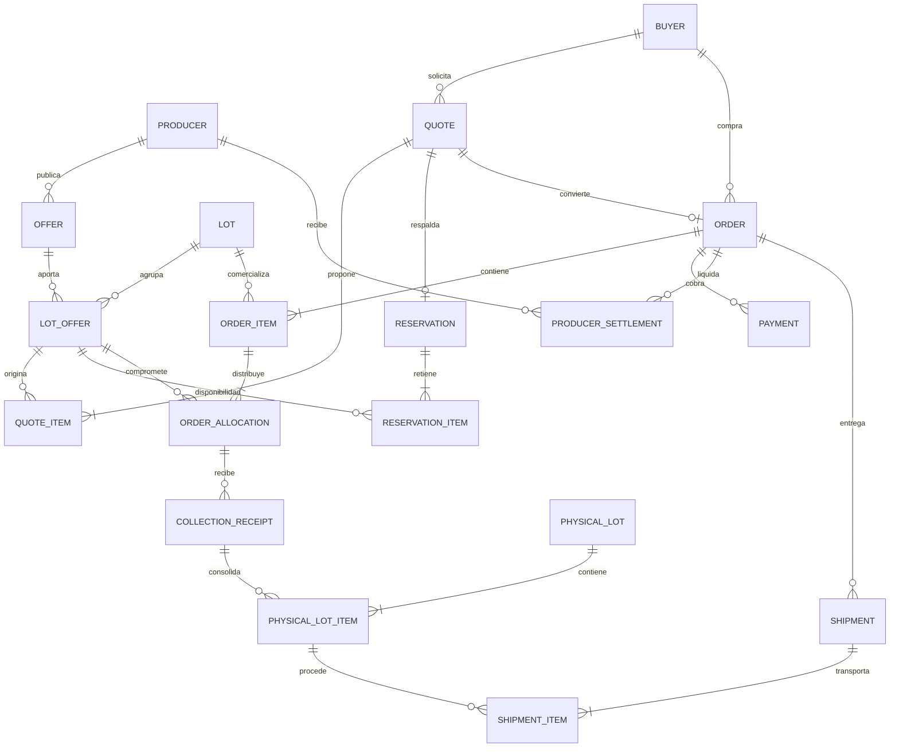

# Fase 0 — Análisis y arquitectura de AgroConecta

Fecha: 8 de septiembre de 2026. Estado: **propuesta de diseño entregada para revisión; sin implementación**. Fuente funcional: prompt maestro aportado por el usuario. Las decisiones comerciales que siguen se identifican como propuestas, no como acuerdos ya celebrados con productores o compradores.

**Actualización posterior:** el usuario confirmó continuar y eligió WhatsApp oficial de Meta a través de Evolution API. Las Fases 1–4 ya tienen infraestructura local, acceso por roles, catálogos y registro/verificación de productores comprobados; [README](../README.md) refleja el avance ejecutado. Este documento conserva el análisis inicial como diseño, no como prueba de implementación de todos sus módulos. La confirmación de Fase 1 ya no está pendiente. [Integración elegida y frontera de seguridad](evolution.md).

En esta fase definimos qué construir, por qué, cómo se relacionan sus partes y cómo comprobarlas después. Solo se crean `README.md` y documentos en `docs/`. No corresponde instalar Laravel, ejecutar Docker ni crear migraciones todavía. El criterio de cierre es cubrir los 18 entregables, resolver contradicciones de diseño y presentar las decisiones para confirmación.

## 1. Resumen técnico y alcance

AgroConecta permite registrar productores sin contraseña, capturar pequeñas ofertas agrícolas mediante mensajería, verificarlas, agrupar cantidades compatibles y vender lotes comerciales parcial o totalmente. Cada compra conserva cuánto aporta cada productor, su precio acordado, la recepción en acopio, los cobros, las liquidaciones y la entrega.

Se propone un **monolito modular Laravel con PostgreSQL como fuente de verdad**, Redis para colas/cache, Nginx y Docker Compose. La web utilizará Blade, Livewire y Tailwind; Alpine se usará cuando aporte una interacción concreta. La API `/api/v1/` y los canales de mensajes utilizarán las mismas acciones de aplicación. La versión base propuesta es Laravel 13 y PHP 8.4, sujeta al cierre de dependencias de la Fase 1; las fuentes y la arquitectura operativa están en [deployment.md](deployment.md).

El MVP incluye los 26 pasos de aceptación del prompt: registro, verificación, ofertas, agregación, marketplace, cotización, reserva/compra parcial, acopio, pesaje, pagos manualmente verificados, liquidaciones, entrega, QR, dashboards y reportes. SMS se integra en su fase mediante un proveedor con recepción viable en Perú. Si las credenciales o la cobertura no están disponibles, se registrará ese bloqueo externo: una prueba con adaptador simulado no se presentará como integración real terminada.

El alcance inicial propuesto es PEN, español, operación en Puno, un lote comercial por checkout y una coordinación de acopio por orden. La base conservará `order_items` para extender el checkout después. Se podrán registrar incidencias y entregas parciales para resolver operaciones reales; un carrito multilote y una optimización automática de rutas quedan fuera de la primera versión.

Se difieren voz/transcripción, IA/NLP, pronósticos, subastas, aplicación móvil, portal de productor, contratos recurrentes, pasarelas bancarias, facturación electrónica y negociación avanzada. Se preparan límites de integración, sin crear implementaciones vacías.

## 2. Actores y permisos

| Actor | Identidad | Facultades y límites |
|---|---|---|
| Administrador | Usuario web | Usuarios, permisos, catálogos, operación, precios, pagos, liquidaciones, reportes y auditoría; toda modificación crítica deja evidencia |
| Coordinador | Usuario web | Verificar productores/ofertas, contactar, agrupar, coordinar acopio, pesar, documentar incidencias y confirmar entregas; sin confirmar cobros ni cambiar comisiones salvo permiso administrativo explícito |
| Comprador | Usuario web y perfil de comprador | Registrarse, consultar, cotizar, reservar, comprar y consultar sus propios pagos, entregas y trazabilidad; no accede al DNI/teléfono de productores |
| Productor | Entidad de dominio identificada por teléfono | Registrarse con asistencia, presentar ofertas, aceptar/proponer/rechazar condiciones, recibir coordinación y consultar su operación por mensajes; no requiere contraseña |
| Visitante | Sin sesión | Consultar marketplace público y la proyección pública autorizada del QR; no reservar ni consultar información privada |
| Proveedores externos | Identidad técnica independiente | Entregar mensajes/eventos o responder consultas a través de adaptadores; no obtienen permisos de usuario administrativo |

Un comprador puede ser restaurante, hotel, tienda, distribuidor, procesador, empresa o individuo autorizado. `buyer_companies` conserva los datos empresariales cuando correspondan. Se propone aprobación operativa antes de habilitar compras, especialmente para compradores individuales; navegar y completar perfil no implica autorización de compra.

El productor es una persona responsable identificada por DNI. Asociación o cooperativa describe su relación productiva; si la contraparte contractual fuera una persona jurídica, deberá definirse su representación y datos adicionales antes de usarla como vendedora. No se sustituye un DNI por un identificador empresarial en el mismo campo.

## 3. Casos de uso

| ID | Actor y precondición | Operación | Resultado verificable o alternativa |
|---|---|---|---|
| CU01 | Teléfono desconocido | Iniciar registro y aportar nombre/tipo | Prerregistro recuperable; DNI capturado por canal seguro; productor pendiente al completar datos |
| CU02 | Coordinador | Revisar identidad y duplicados | Verificación con responsable, fecha y evidencia; rechazo motivado o solicitud de información |
| CU03 | Productor verificado | Vender por diálogo o comando | Oferta pendiente con resumen confirmado y mensaje de origen; ambigüedades se preguntan |
| CU04 | Coordinador | Aprobar/rechazar oferta o pedir información | Historial de estado, condiciones y autorización de cualquier edición |
| CU05 | Productor | Aceptar precio/costos, proponer o rechazar | Acuerdo versionado; ninguna oferta queda comercializable sin condiciones aceptadas |
| CU06 | Coordinador | Sugerir y formar lote manualmente | Cantidades compatibles segregadas; no se duplican kilos entre lotes |
| CU07 | Comprador | Filtrar y revisar un lote | Cantidad disponible, precio estimado, origen agregado y fecha; sin datos personales privados |
| CU08 | Comprador autorizado | Solicitar cotización por cantidad | Cálculo reproducible con asignación candidata, costos y vencimiento; no promete stock reservado |
| CU09 | Comprador autorizado | Reservar o comprar con cotización vigente | Reserva transaccional o conversión a orden; conflicto devuelve disponibilidad actual sin cambiar precio silenciosamente |
| CU10 | Coordinador | Asignar acopio, fecha y responsable | Plan validado por capacidad/horario; productores notificados y pendientes visibles |
| CU11 | Coordinador | Recibir, pesar y evaluar | Recibido, aceptado, rechazado e incidencias por asignación; faltantes requieren resolución |
| CU12 | Comprador / administrador | Registrar pago / revisar evidencia | Cobro confirmado solo después de comprobar recepción; comprobante rechazado conserva historial |
| CU13 | Administrador | Liquidar y registrar desembolso | Neto por productor y saldo pendiente; confirmar cobro del comprador no paga automáticamente al productor |
| CU14 | Coordinador / comprador | Despachar y confirmar entrega | Salida física vinculada a recepción y destinatario; entregas fallidas o parciales registradas |
| CU15 | Comprador / visitante | Consultar QR y trazabilidad | Visibilidad según autorización; proyección pública no contiene DNI, teléfono ni comprador |
| CU16 | Administrador | Consultar KPIs y exportar | Resultados reconciliables con órdenes, pesos, pagos y liquidaciones del período |
| CU17 | Operador técnico autorizado | Reprocesar mensaje/job fallido | Reintento idempotente, con causa y auditoría; no repite una venta o pago |

## 4. Requisitos funcionales

| ID | Requisito | Fases |
|---|---|---|
| RF01 | Sesiones, recuperación de contraseña, roles, políticas por recurso y aislamiento entre compradores | 2 |
| RF02 | Categorías, productos, variedades, calidad, unidades y ubicaciones extensibles; desactivar catálogos referenciados | 3 |
| RF03 | Nombre, DNI, teléfono y tipo obligatorios al completar registro; datos opcionales y verificación/historial | 4 |
| RF04 | Ofertas con cantidad original/normalizada, disponibilidad, localidad, fotos privadas, notas y precio solicitado | 5 |
| RF05 | Estados, aprobación manual, solicitud de información, edición autorizada y publicación separada de recepción del mensaje | 5 |
| RF06 | Máquina conversacional persistida, parser de reglas, resumen, confirmar/corregir/cancelar y recuperación de sesión | 6 |
| RF07 | Simulador `/dev/message-simulator` con el mismo recorrido de dominio; acceso local autorizado | 6 |
| RF08 | WhatsApp oficial desacoplado, webhooks verificados, deduplicación, colas y seguimiento de envíos | 7 |
| RF09 | SMS entrante/saliente por adaptador, con capacidades y limitaciones del proveedor | 8 |
| RF10 | Agrupación sugerida y manual por compatibilidad; lotes comerciales con código y saldos | 9 |
| RF11 | Marketplace y detalle: filtros completos del prompt, cantidad seleccionable y estimación actualizada | 10 |
| RF12 | Referencias de mercado con fuente/fecha/unidad e historial; aceptación o propuesta de precio por productor | 5, 11 |
| RF13 | `PricingService`, desglose, precio ponderado, costos, descuentos financiados y cotización versionada | 11 |
| RF14 | `AllocationService`, FIFO configurable, reserva con caducidad, compra parcial/completa y prevención de sobreventa | 12 |
| RF15 | Puntos de acopio registrados, sugerencia aproximada y decisión del coordinador, capacidad/horarios y notificaciones | 13 |
| RF16 | Recepciones y pesajes por productor, rechazo, faltante, lote físico, transporte y entrega | 14 |
| RF17 | Métodos Yape/Plin/transferencia/presencial/coordinado, comprobantes privados, revisión, reembolsos y saldos | 15 |
| RF18 | Liquidaciones por productor, monto bruto, costos, neto, desembolsos y conciliación | 15 |
| RF19 | Eventos de trazabilidad desde la captura, consulta autorizada, URL pública limitada y QR | 5–16 |
| RF20 | Notificaciones a productores, web/email para compradores, eventos fallidos y reintentos observables | Desde 6 |
| RF21 | Dashboards operativos/comprador, métricas de impacto, gráficos, mapa si hay coordenadas y reportes Excel/CSV/PDF | 17 |
| RF22 | Auditoría de verificaciones, cantidades, precios, cancelaciones, pagos, permisos y liquidaciones | Desde 2 |
| RF23 | API REST versionada, errores claros, paginación, autorización e idempotencia de acciones críticas | Por módulo |
| RF24 | Docker local, ejecución asíncrona, backups, restauración, logs, pruebas y despliegue reproducible | 1, 18–20 |

El mapa administrativo podrá mostrar productores, ofertas, acopios, compradores y lotes si existen coordenadas y autorización. La ausencia de GPS no impedirá el registro; una ubicación ambigua sí impedirá prometer una logística concreta hasta aclararla.

## 5. Requisitos no funcionales

Estos son objetivos propuestos para el piloto, no mediciones ya alcanzadas.

| Área | Criterio de aceptación previsto |
|---|---|
| Integridad | Disponibilidad nunca negativa; una confirmación repetida produce una sola orden; saldos reconstruibles desde registros de detalle |
| Seguridad | Validación en servidor, CSRF web, salida escapada, consultas parametrizadas, permisos por registro, límites de frecuencia y secretos fuera del código |
| Privacidad | DNI/teléfono/ubicación precisa restringidos; documentos/comprobantes privados; anonimización del QR y logs sin cuerpos sensibles |
| Rendimiento | Objetivo inicial p95 menor de 2 s para catálogo/cotización bajo un ensayo de 25 compradores concurrentes y 10 000 ofertas; medir hardware y excluir latencia externa claramente |
| Mensajería | Webhook acusa recepción tras persistencia durable; objetivo interno p95 menor de 1 s para esa admisión; procesamiento posterior con reintentos y alerta por atraso |
| Operación | Objetivo orientativo de disponibilidad mensual 99,5 %; un solo host no implica alta disponibilidad; recuperación y pérdida máxima propuestas en despliegue |
| Accesibilidad | Objetivo WCAG 2.2 AA: teclado, foco visible, formularios etiquetados, errores comprensibles y estados con texto además de color |
| Conectividad | Mensajes cortos, una pregunta por vez, reanudación; páginas paginadas y ligeras; no se promete funcionamiento web sin conexión |
| Localización | Español inicial; textos preparados para `es`, `qu`, `ay`; fechas explícitas, kg y PEN; instantes UTC mostrados en `America/Lima` |
| Mantenibilidad | Monolito, reglas fuera de controladores, pruebas por fase y dependencias bloqueadas; sin microservicios, Kubernetes ni abstracciones genéricas innecesarias |
| Trazabilidad | Cambios comerciales auditados; eventos públicos separados de auditoría privada; registros históricos no se borran al desactivar actores |
| Portabilidad | Misma imagen de aplicación para web/queue/scheduler; despliegue Linux con Docker, migraciones controladas y restauración ensayada |

Las políticas por modelo de Laravel son una base adecuada para controlar quién puede actuar sobre cada recurso; ocultar botones no constituye autorización. [Laravel Authorization](https://laravel.com/framework/docs/13.x/authorization). Los criterios de accesibilidad se comprobarán contra [WCAG 2.2](https://www.w3.org/TR/WCAG22/).

No se declara cumplimiento jurídico por tener casillas de consentimiento. Antes del piloto real deberán definirse responsable del tratamiento, finalidad, conservación, ejercicio de derechos y términos comerciales, con la revisión aplicable en Perú. Aquí se diseña minimización y control de acceso; no se prescribe un régimen tributario ni se fija una tasa fiscal.

## 6. Arquitectura propuesta

Las entradas son controladores HTTP, componentes Livewire, comandos internos y adaptadores de mensajes. Todos invocan acciones de aplicación que validan reglas, permisos y transacciones. Los modelos Eloquent representan datos; servicios de dominio concentran asignación, precios, compatibilidad, acuerdos y estados. Infraestructura implementa bases de datos, colas, archivos y proveedores externos.

Se utilizarán convenciones Laravel, organizando acciones y servicios por módulo. No es necesario convertir cada módulo en un paquete independiente ni envolver Eloquent en repositorios genéricos. Los módulos pueden compartir transacciones PostgreSQL cuando la operación lo requiere.

Servicios concretos previstos: `MessagingService`, `ConversationService`, `ParserService`, `OfferVerificationService`, `AggregationService`, `AllocationService`, `PricingService`, `ReservationService`, `CheckoutService`, `CollectionPlanningService`, `PaymentReviewService`, `SettlementService` y `TraceabilityService`. Se implementarán en su fase, no como archivos vacíos.

Interfaces externas: `MessagingProviderInterface`, `MarketPriceProviderInterface` y, cuando se integre una pasarela, `PaymentGatewayInterface`. El pago manual será un flujo interno de revisión, sin fingir una pasarela bancaria. Una futura transcripción recibirá un adjunto y devolverá texto al mismo flujo, con confirmación del productor.

PostgreSQL guardará inventario, reservas, estados, precios acordados, mensajes recibidos y una bandeja transaccional de eventos pendientes (`outbox_events`). Redis transportará trabajo y cache; perder Redis no debe perder una compra ni la intención de notificar. Un publicador recuperará eventos pendientes; los consumidores serán idempotentes. Esto requiere una tabla y jobs dentro del monolito, no otro sistema distribuido.

La configuración de colas deberá impedir ejecutar acciones antes del commit. `after_commit` ayuda con el orden de despacho, pero la outbox cubre además el fallo entre confirmar datos y publicar trabajo. [Laravel Queues](https://laravel.com/framework/docs/13.x/queues).

**Contratos API previstos, aún no implementados:**

| Ruta o recurso | Acceso y comportamiento |
|---|---|
| `GET /api/v1/products`, `GET /api/v1/lots` | Catálogo público limitado y paginado |
| `POST /api/v1/quotes` | Comprador autorizado; cantidad y lote; cálculo en servidor |
| `POST /api/v1/reservations` | Comprador propietario de quote; reserva atómica y vencimiento |
| `POST /api/v1/orders` | Confirmación idempotente de quote/reserva; una orden por conversión |
| `GET /api/v1/orders/{id}` | Comprador propietario o personal autorizado |
| `POST /api/v1/orders/{id}/payments` | Registrar intento/comprobante; no confirma recepción del dinero |
| `GET/POST /api/v1/webhooks/whatsapp` | Challenge de configuración y firma de recepción; sin sesión de usuario |
| `POST /api/v1/webhooks/sms` | Verificación propia del adaptador SMS |
| `GET /api/v1/trace/{token}`, `GET /trace/{token}` | Solo proyección pública aprobada |

Sesión/cookie segura para la web; tokens con alcance para futuros clientes mediante mecanismo Laravel apropiado. CSRF solo se exceptúa en los webhooks autenticados por el proveedor. Errores esperados: `422` por datos inválidos, `403` por falta de permiso, `409` por stock/versión en conflicto, `410` por cotización vencida y `429` por límite. El contrato definitivo se documentará con cada módulo.

**Estructura futura, no creada todavía:**

```text
E:/VSCODE/Agroconecta/
  README.md
  docs/{architecture,database,messaging,deployment,roadmap}.md
  docker-compose.yml
  docker/{php,nginx}/
  application/
    app/
      Actions/{Producers,Offers,Lots,Quotes,Orders,Logistics,Payments}/
      Services/{Messaging,Pricing,Allocation,Traceability}/
      Contracts/
      Integrations/{Messaging,MarketPrices}/
      Models/  Enums/  Policies/  Jobs/  Notifications/
      Http/{Controllers,Requests,Resources}/
      Livewire/
    config/  routes/  resources/{views,css,js}/  lang/
    database/{migrations,factories,seeders}/
    tests/{Unit,Feature,Integration}/
  .github/workflows/
```

## 7. Diagrama textual de arquitectura

```text
PRODUCTOR                                 COMPRADOR / ADMIN / COORDINADOR
  | WhatsApp / SMS                                       | Web HTTPS
  v                                                      v
Proveedor oficial --> NGINX --> Laravel HTTP / Blade / Livewire
                         |               |
                  Webhook firmado        | API / acciones autorizadas
                         v               v
               Inbox durable --> LÓGICA DE APLICACIÓN
                         |       Productores -> Ofertas -> Lotes
                  Redis / Queue       -> Cotizaciones -> Reservas
                         |            -> Órdenes / Asignaciones
                         v            -> Acopio / Lotes físicos
                    Worker            -> Pagos / Liquidaciones
                         |            -> Entrega / Trazabilidad
                         +-------------+---------+
                                       |
                       PostgreSQL + archivos privados
                                       |
                              Outbox de eventos
                                       |
                          Worker / Notificaciones
                                       |
                         WhatsApp / SMS / Email / Web

Scheduler -> vencimientos, outbox pendiente, alertas y trabajos programados
Visitante -> /trace/{token} -> proyección pública con datos autorizados
```

## 8. Lista de módulos

| Módulo | Responsabilidad y datos principales |
|---|---|
| Identidad y acceso | Usuarios, roles, permisos, sesiones y perfiles de comprador |
| Productores | Prerregistro asistido, identidad, verificación, ubicación e historial |
| Catálogos | Categorías, productos, variedades, unidades, calidad y geografía |
| Mensajería | Adaptadores, inbox, conversaciones, parser, intentos y capacidades por canal |
| Ofertas | Captura, verificación, evidencia, acuerdos comerciales y disponibilidad |
| Referencias de mercado | Registro manual con fuente, historial y futuros proveedores |
| Agregación y lotes comerciales | Compatibilidad, sugerencias, composición y saldos |
| Marketplace | Búsqueda, filtros, detalle y consulta pública comercial |
| Precios y cotizaciones | Desglose, asignación candidata, snapshots y vigencia |
| Reservas y asignación | Retención temporal y compromiso definitivo por oferta |
| Órdenes | Checkout, condiciones de entrega/pago, cambios acordados y cancelaciones |
| Acopio | Puntos, planes, citas, capacidad, recepciones, calidad e incidencias |
| Logística física | Consolidación, lotes físicos, transporte, despacho y entrega |
| Pagos | Intentos, comprobantes, revisión, cobros, devolución y conciliación |
| Liquidaciones | Obligación y desembolsos al productor, costos y neto |
| Trazabilidad | Eventos por origen, cadena física y comercial, QR y permisos de publicación |
| Notificaciones | Mensajes de negocio vía Laravel Notifications y estado de entrega |
| Analítica y reportes | KPIs, impacto económico, cohortes, gráficos, mapa y exportaciones |
| Auditoría y operación | Cambios críticos, errores, jobs, reintentos y correlación |

## 9. Modelo de datos preliminar

Las entidades centrales son `Producer → Offer → LotOffer → Lot`, `Quote → QuoteItem`, `Reservation → ReservationItem` y `Order → OrderItem → OrderAllocation`. Una asignación conserva la oferta y el productor de origen, la cantidad y el acuerdo económico. No se guarda únicamente el total del lote.

La cadena física es `CollectionEvent → CollectionReceipt → PhysicalLotItem → PhysicalLot → ShipmentItem`. Cada recepción referencia una asignación de compra. El pago recibido pertenece a una orden; la obligación y el desembolso al productor pertenecen a su liquidación. Trazabilidad y auditoría tienen fines distintos.

El [diccionario completo](database.md) analiza todas las tablas mínimas del prompt, las tablas puente y las adiciones necesarias: reservas, acuerdos, recepciones, lotes físicos, ajustes, desembolsos, consentimiento y outbox. Detalla tipos, restricciones y límites transaccionales.

## 10. ERD propuesto

Vista central; el [ERD por dominios con claves](database.md#erd-por-dominios) amplía pagos, identidad, logística y mensajería.



## 11. Estados principales y transiciones

Un estado se cambia mediante una acción autorizada con fecha, actor, motivo y evidencia. No habrá un endpoint genérico que permita escribir cualquier estado. Los saldos de inventario, cobro y entrega no se deducen de una única etiqueta.

| Entidad | Ciclo principal | Alternativas y condiciones |
|---|---|---|
| Producer | `PENDING_VERIFICATION → VERIFIED` | `REJECTED` con motivo; corrección autorizada vuelve a pendiente. `VERIFIED ↔ SUSPENDED`; `ARCHIVED` bloquea nuevas ofertas y preserva historial. El prerregistro incompleto vive en Conversation |
| Offer | `DRAFT → PENDING_VERIFICATION → VERIFIED → PUBLISHED` | `NEEDS_INFORMATION` vuelve a pendiente al completar; `REJECTED`, `CANCELLED`, `EXPIRED` conservan evidencia. Publicar exige productor verificado, compatibilidad, cantidad normalizada y acuerdo comercial aceptado |
| Lot comercial | `DRAFT → PUBLISHED → CLOSED` | `PAUSED` evita nuevas reservas; `CANCELLED` solo sin compromisos pendientes. Se cierra al resolver el saldo y sus operaciones |
| Quote | `DRAFT → ISSUED → ACCEPTED` | `EXPIRED`, `CANCELLED`, `SUPERSEDED`; aceptar significa conversión a orden, una sola vez. Emitida exige importe reproducible y vencimiento |
| Order | `CONFIRMED → IN_FULFILLMENT → FULFILLED → CLOSED` | `ON_HOLD` con estado previo/motivo; `CANCELLED` solo con resolución de reservas, mercancía y dinero. Cierre requiere entrega/resolución y saldos conciliados |
| Payment | `PENDING → PROOF_UPLOADED → UNDER_REVIEW → CONFIRMED` | `REJECTED` requiere nuevo intento/evidencia; `CANCELLED` si no se recibió dinero. Presencial puede pasar a revisión con constancia. `PARTIALLY_REFUNDED → REFUNDED` mediante devoluciones verificadas |
| Shipment | `PLANNING → SCHEDULED → COLLECTING → READY → IN_TRANSIT → DELIVERED` | `PARTIALLY_DELIVERED`, `FAILED`, `CANCELLED`; una reprogramación deja evento, no borra el intento. Despacho exige peso aceptado y condición de pago satisfecha o excepción autorizada |

Para Offer, `PARTIALLY_ALLOCATED`, `ALLOCATED`, `SOLD` se muestran como **estado de asignación derivado** de sus cantidades, no como sustitutos de aprobación/publicación. Para Lot se muestra `AVAILABLE`, `PARTIALLY_RESERVED`, `RESERVED`, `PARTIALLY_SOLD`, `SOLD_OUT` con los saldos correspondientes. Un lote agotado por reservas puede recuperar disponibilidad cuando estas vencen. Un lote vendido y entregado no la recupera.

Estados auxiliares necesarios: Reservation `ACTIVE → CONVERTED | EXPIRED | CANCELLED`; PhysicalLot `RECEIVING → READY → DISPATCHED → CLOSED` con `QUARANTINED` ante problemas; ProducerSettlement `DRAFT → APPROVED → PARTIALLY_PAID → PAID`, o `DISPUTED/CANCELLED` si procede. La orden tendrá resúmenes derivados de pago y entrega para representar, por ejemplo, una entrega completada con saldo pendiente.

Suspender un productor u oferta bloquea nuevas operaciones, pero no cancela silenciosamente compras vigentes: abre una incidencia que el coordinador debe resolver. Un rechazo de calidad después del pesaje tampoco devuelve automáticamente stock al marketplace.

## 12. Flujo completo y reglas económicas

1. Un teléfono envía `HOLA`. Se abre conversación y se informa el uso de datos y mensajes. Se recogen nombre y tipo; se guarda el prerregistro.
2. El DNI se completa por el coordinador en un formulario administrativo seguro; alternativamente podrá ofrecerse un enlace HTTPS de un solo uso sin contraseña. Completados nombre/DNI/teléfono/tipo, se crea Producer pendiente. El coordinador verifica y registra evidencia.
3. Ya verificado, el productor envía `QUINUA 80KG CABANA`. El parser reconoce datos conocidos y solicita variedad, ubicación precisa o fecha cuando falten. El comando no inventa precio, calidad ni disponibilidad temporal.
4. Se presenta un resumen; al confirmar se registra Offer pendiente. El coordinador verifica, acuerda precio bruto/costos/neto y publica. Aceptar, proponer o rechazar condiciones genera un registro versionado.
5. Se reúnen ofertas compatibles. La sugerencia considera producto, variedad, calidad, localidad, ventana de entrega y condiciones económicas. El coordinador confirma el lote y sus cantidades segregadas.
6. El comprador abre el marketplace, selecciona lote y cantidad. `AllocationService` filtra elegibilidad y propone participaciones FIFO por fecha disponible, fecha publicada e ID; `PricingService` calcula a partir de esas mismas participaciones.
7. Se emite Quote con vencimiento. Propuesta inicial: cotización válida 15 minutos; reserva solicitada explícitamente hasta 10 minutos, sin superar la cotización. Son parámetros por validar en el piloto. Cotizar no retiene kilos.
8. Al reservar se vuelven a comprobar precio, versiones y stock bajo bloqueo transaccional. Se evalúa el vencimiento de quote/reserva con el reloj de PostgreSQL después de obtener los bloqueos, tanto al reservar como al comprar. Al comprar se convierte la reserva a compromisos de orden en una sola transacción; una compra directa realiza esa validación y compromiso sin una espera intermedia. Cualquier cambio material exige nueva aceptación.
9. La orden guarda condiciones de pago y entrega. El coordinador asigna punto, fecha, capacidad y responsable. Se envía a cada productor únicamente su participación y su coordinación.
10. En acopio se registra cantidad esperada, recibida, rechazada y aceptada por asignación. Se conserva el peso real y se crea la composición física. Faltantes o reemplazos generan una propuesta de ajuste, aceptación cuando cambia lo comprado y cálculo de saldo/reembolso.
11. El comprador registra el método y evidencia de pago. El administrador comprueba el ingreso antes de confirmar. La transferencia bancaria o el uso de Yape/Plin sucede fuera del sistema durante el MVP.
12. Se calculan liquidaciones por cantidad aceptada y acuerdo económico congelado en cada asignación de la orden, más ajustes expresamente aprobados. Se aprueban y se registran desembolsos reales con evidencia. Se distingue obligación devengada de dinero pagado al productor.
13. Se despacha el producto aceptado, se confirma entrega y se registran incidencias. La orden se cierra cuando mercancía, cobros, devoluciones y liquidaciones están resueltos.
14. Los eventos alimentan la trazabilidad y el dashboard. El QR del lote comercial explica su composición; los lotes físicos tienen identificadores propios para rastrear cada despacho. La consulta pública usa datos autorizados y puede revocarse.

**Corrección necesaria del onboarding:** la política oficial de WhatsApp Business prohíbe pedir identificadores personales completos. Se conserva el DNI obligatorio para verificar al productor, cambiando su canal de captura y manteniendo asistencia humana para quien no pueda usar la web. Véase [política de WhatsApp, sección 3](https://whatsappbusiness.com/policy/) y [diseño de mensajería](messaging.md). Esta corrección responde a una incompatibilidad concreta del flujo original.

**Precio transparente.** Por cada aporte se calcula `cantidad × precio bruto aceptado`. El precio ponderado es la suma de esos importes dividida entre la cantidad. Al comprador se muestran subtotal, cargo de plataforma a su cargo, logística a su cargo, descuento y tributos aplicables. Al productor se muestran bruto menos comisión, logística y otros costos a su cargo, igual a neto. Un mismo costo no se cobra dos veces a ambas partes. Cada descuento identifica quién lo financia; no reduce unilateralmente el neto acordado. La referencia de mercado es informativa y tiene fuente/fecha; no reemplaza el precio aceptado.

El prompt muestra pago antes y después de entrega. Se resuelve con **condición de pago explícita por orden**: propuesta predeterminada de pago comprobado antes del despacho, con pago presencial/contraentrega o coordinado permitido mediante acuerdo administrativo. Una fecha comprometida de pago al productor debe constar desde el acuerdo; no se asume crédito al comprador ni adelantos financiados por AgroConecta.

La ecuación, el ejemplo numérico exclusivamente didáctico, los redondeos, la disponibilidad y la conciliación se desarrollan en [database.md](database.md).

## 13. Arquitectura Docker

| Servicio | Función | Persistencia y exposición |
|---|---|---|
| `nginx` | HTTP local y entrada HTTPS en producción; archivos públicos | Solo servicio web expuesto al público |
| `app` | PHP-FPM/Laravel | Acceso a base y almacenamiento privado; sin puerto FPM público |
| `postgres` | Operación transaccional e inbox/outbox | Volumen durable y backup externo; puerto privado |
| `redis` | Queue/cache | Acceso privado; persistencia de colas y recuperación desde outbox |
| `queue` | Worker de la misma imagen de aplicación | Mensajes, notificaciones, reportes, QR y trabajos externos |
| `scheduler` | Programación del monolito | Vencimientos, outbox pendiente y tareas periódicas; no es un microservicio |
| `mailpit` | Correo de desarrollo opcional | Solo entorno local |

Composer y Node/Vite se necesitan para construir dependencias/assets; no se necesita un servidor Node permanente en producción. Se usarán volúmenes, red interna, healthchecks y migraciones controladas. No se ejecutarán migraciones simultáneamente desde todos los contenedores. El detalle Windows/WSL2, imágenes, salud y backups está en [deployment.md](deployment.md).

## 14. Integraciones externas necesarias

| Integración | MVP y dependencia real | Alternativa de desarrollo |
|---|---|---|
| WhatsApp | Cloud API oficial de Meta: cuenta habilitada, teléfono, credenciales, webhook HTTPS y plantillas cuando proceda | `FakeWhatsAppProvider` y simulador, claramente identificados |
| SMS | Proveedor con recepción y envío comprobados para Perú; autenticación y restricciones verificadas antes de contratar | Adaptador de prueba; no declarar recepción real hasta probarla |
| Correo | SMTP/proveedor para recuperación de acceso y avisos; configurar dominio y entrega | Mailpit local |
| Precios de mercado | Registro manual documentado; interfaz para fuente oficial/API validada después | Datos didácticos solo en demo, etiquetados |
| Pagos | Yape/Plin/banco/presencial con revisión humana; datos del receptor reales configurados por administrador | Pruebas aisladas sin transferir dinero |
| Mapa | Visualización con proveedor de mapas/teselas sujeto a atribución, disponibilidad y términos; no se asume servidor gratuito ilimitado | Tabla por localidad y acopios sin GPS |
| Cloud, DNS y HTTPS | Selección por costo total, operación, almacenamiento y restauración | Docker local hasta Fase 20 |
| Backups/archivos | Destino externo privado y cifrado; capacidad según volumen de evidencias | Almacenamiento local privado para desarrollo |

No se requiere IA, RENIEC, integración bancaria, pasarela de pago ni servicio de QR externo para iniciar. Validar el formato de un DNI no prueba identidad ni acredita una consulta a una entidad oficial. El QR se genera localmente a partir de una URL controlada.

## 15. Riesgos técnicos y respuesta de diseño

| Riesgo | Consecuencia | Tratamiento |
|---|---|---|
| Capturar DNI íntegro por WhatsApp | Flujo incompatible con política del canal | Captura segura asistida; no solicitarlo ni repetirlo en mensajes |
| Confundir quote con stock reservado | Dos compras sobre los mismos kilos | Reservas persistidas, bloqueo por oferta y conversión atómica |
| Sumar una oferta en varios lotes sin segregar | Disponibilidad artificial | `lot_offers` con capacidad asignada y control global sobre oferta |
| Usar Redis como inventario único | Pérdida o carreras de stock | PostgreSQL conserva saldos y compromisos; cache solo acelera lecturas |
| Precios o cantidades editados después de compra | Se altera un acuerdo histórico | Snapshots, versiones y ajustes explícitos con evidencia |
| Mensajes duplicados/fuera de orden | Doble registro o conversación incoherente | Identidad del evento, secuenciación por conversación y confirmaciones con versión |
| Reintento de pago o notificación | Doble desembolso o mensaje repetido | Idempotencia de dominio; conciliación de resultado externo incierto |
| Confundir peso prometido con recibido | Liquidaciones incorrectas o venta inexistente | Recepción física separada y resolución de diferencias |
| Convertir sacos/arrobas automáticamente | Errores de volumen y precio | Factor documentado específico; pedir peso cuando sea ambiguo |
| Exponer datos por QR, fotos, logs o reportes | Fuga de información | Proyección pública explícita, almacenamiento privado y autorización por descarga |
| Hardening y pruebas solo al final | Defectos estructurales tardíos | Seguridad, auditoría y pruebas desde cada módulo; fases 18/19 consolidan |
| Backup sin restauración probada | Recuperación imposible | Copia externa, claves recuperables y simulacro de restauración |

## 16. Riesgos empresariales y medición

| Riesgo | Regla o experimento propuesto |
|---|---|
| Agregar kilos incompatibles o lejos entre sí | Piloto con zonas/productos y acopios delimitados; reglas de calidad, ventana y capacidad verificadas |
| El costo de acopio supera la mejora del precio | Mostrar neto antes de aceptar; comparar con alternativa local equivalente incluyendo todos los costos |
| Productor vende por otro canal o no entrega | Confirmación de disponibilidad, vencimiento de ofertas y seguimiento; registrar faltantes sin inventar sanciones |
| Falta de compradores recurrentes | Medir repetición por cohortes, motivos de abandono y cumplimiento de pedidos |
| Precio referencial desactualizado o sesgado | Fuente, fecha, mercado, unidad y advertencia de antigüedad; no llamarlo oficial sin respaldo |
| Disputas por calidad/peso | Criterios pactados, balanza identificada, evidencia y procedimiento de revisión |
| Cobro tardío y obligación de pagar al productor | Condiciones de pago explícitas y política de crédito/adelantos antes de asumir riesgo financiero |
| Cuello de botella del coordinador | Medir tiempo de verificación, mensajes sin atender y carga por localidad |
| Teléfono compartido, perdido o reasignado | Ruta asistida para cambio de titular; no reasignar productor automáticamente ni revelar historial por posesión del número |
| Dependencia del canal y conectividad | SMS cuando sea viable, atención humana y reanudación; medir costos reales de mensajería |
| Rol contractual/fiscal indefinido | Antes de operar dinero real, definir quién vende, quién cobra, quién factura, responsabilidades y devoluciones; el software no presume ser escrow |

Métricas del experimento:

- **Neto productor por kg:** neto liquidado devengado / kg aceptados liquidables; mostrar también neto efectivamente pagado y fecha.
- **Mejora económica:** diferencia y porcentaje frente al neto alternativo documentado para mismo producto, calidad, localidad y fecha. Guardar origen y costos de esa comparación. Sin comparación válida, mostrar “sin base comparable”; no atribuir causalidad al sistema.
- **Conversión de volumen:** kg efectivamente vendidos / kg publicados del mismo grupo de ofertas, sin contar republicaciones como oferta nueva.
- **Entregas puntuales:** entregas completadas antes del límite acordado / entregas que debían completarse en el período, incluyendo las vencidas pendientes.
- **Recompra:** compradores con segunda compra completada dentro de 90 días / compradores con primera compra y 90 días de seguimiento. Ventana inicial propuesta; mostrar cohortes aún inmaduras por separado.
- **Repetición productor:** productores con otra operación completada en 90 días / productores elegibles con seguimiento suficiente.
- **Tiempo de pago:** mediana y p90 entre aceptación en acopio y desembolso completo; saldos impagos y días de atraso se muestran aparte.
- **Rechazo de calidad:** kg rechazados / kg recibidos; nunca mezclar kilos prometidos en el denominador.
- **GMV:** valor del producto efectivamente vendido, ajustado por devoluciones, separado de reservas, logística e ingreso propio de la plataforma.
- **Margen por transacción:** ingreso propio menos costos propios de operación/mensajería/logística/subsidios atribuibles; no confundir dinero cobrado para productores con ingreso AgroConecta.

La definición del período, moneda, impuestos incluidos/excluidos y base de devengo/caja acompañará cada reporte. El dashboard mostrará contadores solicitados, gráficos mensuales, pendientes y mapa; las exportaciones reconciliarán con el mismo filtro aplicado en pantalla.

## 17. Decisiones para mantener simple el MVP

Se propone una aplicación, una base de datos y despliegue en un host al inicio; revisión manual de identidad/ofertas; precios de referencia manuales con fuente; FIFO determinista; una compra de un lote por checkout; puntos de acopio existentes; pagos y desembolsos comprobados por personas; mapas orientativos; reportes desde PostgreSQL y jobs para exportaciones grandes.

Las simplificaciones no eliminan reservas, recepciones físicas, acuerdos económicos, reembolsos ni trazabilidad: omitirlos provocaría inconsistencias en operaciones normales. Se mantendrán tipos de calidad y variedades explícitos, incluso “sin especificar”, y no se mezclarán con una calidad conocida sin revisión.

Decisiones de negocio por validar antes de su fase: criterios de verificación (4–5), comisión y quién soporta cada costo (5/11), mínimos de compra y vigencias (11–12), tolerancias de peso/calidad y cancelación (12–14), plazo de pago al productor y receptor del dinero (15), tratamiento fiscal/comercial antes del piloto real, presupuesto/volumen y objetivos de recuperación antes de cloud (20). No impiden analizar la arquitectura ni obligan a decidir hoy un proveedor cloud.

## 18. Roadmap y cierre de Fase 0

Se conserva el orden solicitado: 1 entorno; 2 autenticación; 3 catálogos; 4 productores; 5 ofertas; 6 simulador; 7 WhatsApp; 8 SMS; 9 lotes; 10 marketplace; 11 precios/cotizaciones; 12 compras/reservas; 13 acopio; 14 logística; 15 pagos/liquidaciones; 16 trazabilidad/QR; 17 dashboards; 18 hardening; 19 testing integral; 20 cloud.

El [roadmap detallado](roadmap.md) indica resultado, archivos, comandos futuros y pruebas de salida para cada fase. Los registros de auditoría y trazabilidad se capturan desde las fases que los producen: en 16 se construye la consulta/QR, no se reconstruye información perdida. Las pruebas y permisos tampoco se posponen hasta 18/19.

**FASE 0 COMPLETADA — entrega documental del 8 de septiembre.** Este cierre corresponde al diseño inicial. Desde entonces se implementó y ejecutó la aplicación; el estado actual y sus decisiones concretas se describen a continuación.

El apartado 70 exigía confirmación antes de Fase 1; **esa confirmación fue recibida** mediante la instrucción posterior “continúa”. La implementación avanza con las comprobaciones de salida descritas en el roadmap.

## 19. Implementación comprobada al 19 de septiembre de 2026

Las fases 1–6 y 9–19 funcionan en Docker local. Las fases 7–8 tienen adaptadores y contratos probados, con conexión real pendiente. La validación añade reportes, seguridad, recorrido E2E de 220 kg y restauración aislada. Despliegue, capacidad bajo carga real y recuperación externa pertenecen a fase 20.

El checkout opera sobre un lote por compra. Pricing selecciona aportes concretos por FIFO o por precio y FIFO, conserva acuerdos y políticas, y calcula con BCMath. Cotizar no reserva; la reserva tiene vencimiento y su confirmación vuelve a comprobar elegibilidad y saldo. Cantidades usan tres decimales e importes enteros en céntimos. Las reducciones conservan la compra original y exigen aceptación explícita del comprador.

Los servicios de dominio comparten un bloqueo transaccional sobre la fila del rol administrador antes de bloquear registros específicos. Este protocolo serializa cambios de acceso, inventario y comercio para evitar carreras entre módulos; favorece la consistencia del MVP y limita el rendimiento de escrituras concurrentes. Las pruebas de reserva, vencimiento, reembolso y desembolso usan procesos y conexiones reales de PostgreSQL. La vigencia se evalúa con el reloj de la base después de adquirir los bloqueos.

La cadena física enlaza aportación comprada → recepción → lote físico → despacho. El pesaje separa recibido, aceptado y rechazado; las incidencias conservan diferencias y pérdidas. Consolidar o despachar consume cantidades existentes, sin reponer automáticamente stock por un faltante. La planificación respeta capacidad y usa coordenadas únicamente con consentimiento vigente para ese propósito.

Los cobros y desembolsos tienen revisión manual; el sistema no ejecuta transferencias. Confirmar un ingreso no confirma un pago al productor. Las liquidaciones usan peso aceptado y condiciones congeladas; sus revisiones conservan obligaciones y descuentan desembolsos anteriores. Un resultado externo incierto mantiene el importe comprometido hasta su conciliación. El cierre exige saldos resueltos, ausencia de incidencias y liquidaciones vigentes.

Las notificaciones internas y los avisos al productor parten del outbox. Antes de enviar se comprueban vigencia del evento, destinatario y consentimiento; una reprogramación cancela avisos obsoletos. Reintentar un aviso bloqueado sin mensaje creado vuelve a evaluar estas condiciones. Los canales reales permanecen sujetos a la habilitación y validación externa de fases 7–8.

La trazabilidad privada respeta el propietario de la orden y los permisos del operador. El QR apunta a una publicación pública con snapshot limitado, token aleatorio y revocación; no publica DNI, teléfono, comprador, documentos ni ubicación exacta. Se genera SVG localmente, sin enviar datos a un proveedor de QR. Los enlaces localhost sirven en este equipo; probar el escaneo desde otro dispositivo requiere una URL accesible configurada antes de publicar.

El escenario local recorre una compra sintética de 25.125 kg hasta cierre, con S/ 128.14 conciliados al comprador y S/ 113.07 al productor. Su creación es explícita e idempotente mediante `CommerceWalkthroughSeeder`; no se ejecuta al arrancar. La guía de reproducción y los límites del escenario están en [local-testing.md](local-testing.md#probar-el-recorrido-comercial-fases-1116).

Reportes utiliza un corte explícito por confirmación de orden y documentos Excel/CSV/PDF generados localmente, sin nuevas dependencias. Ocho gráficos operativos y seis del comprador comparten el cálculo. Mapa y exportaciones respetan permisos, consentimiento y propiedad; las descargas tienen vencimiento.

La protección HTTP añade lista de hosts, CSP del mismo origen, encabezados de privacidad, límites de escritura/webhooks y log reducido. Producción exige HTTPS/cookies seguras y oculta diagnósticos. La lista de proxies TLS confiables debe concretarse al desplegar.

CompleteJourneyTest recorre alta desde mensajería hasta compra de 220 kg, recepción, entrega, conciliación, QR y reporte; se prohíben llamadas externas. El ensayo de restauración contrasta PostgreSQL, archivos privados, claves originales y evidencias en una base temporal. No respalda Redis ni Evolution.
