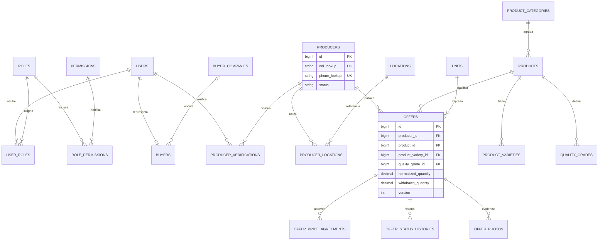
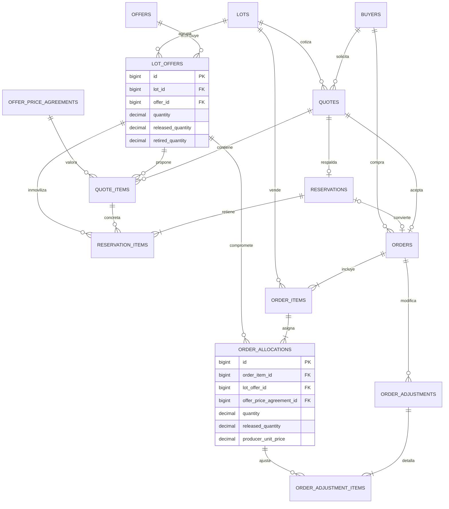
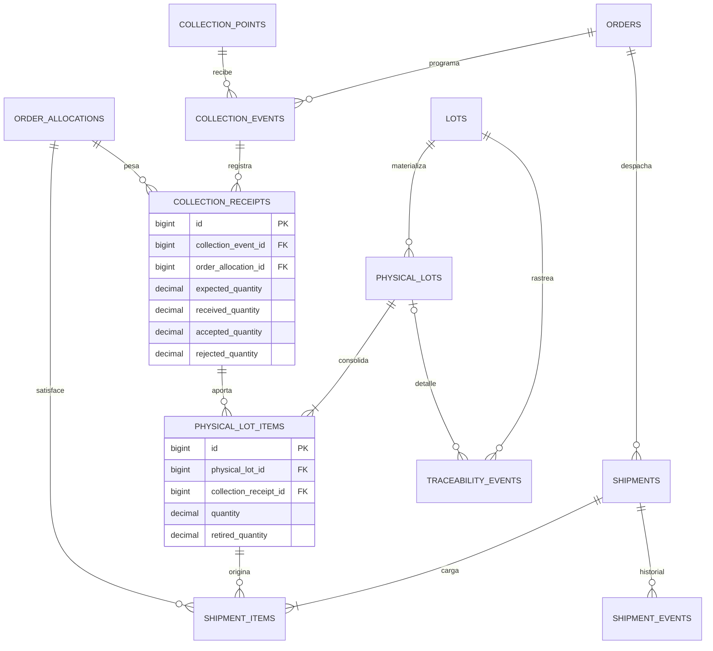
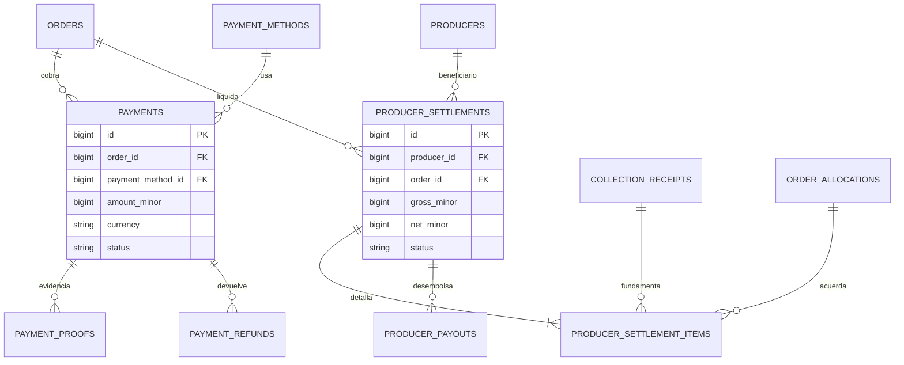
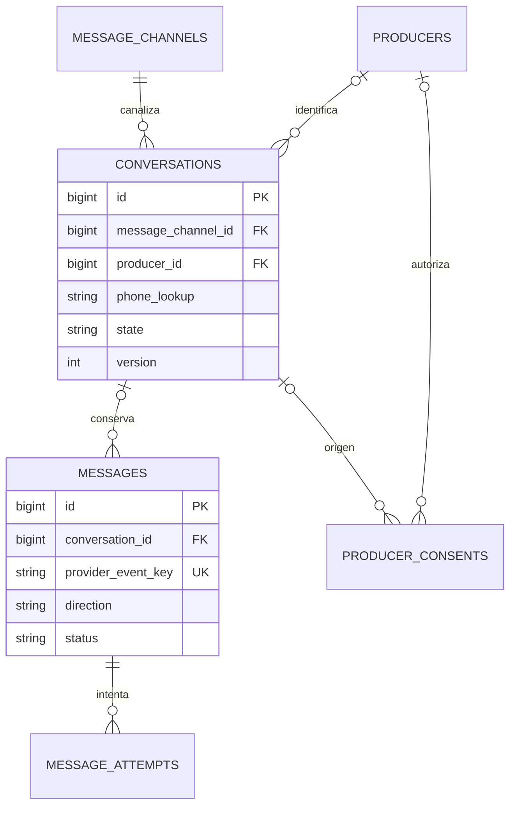

# AgroConecta — modelo de datos e implementación

Diseño original de Fase 0, 8 de septiembre de 2026. Las tablas y protocolos de módulos futuros que se describen abajo son propuestas; las actualizaciones de implementación indican qué migraciones ya existen. El ciclo de estados funcional está en [architecture.md](architecture.md#11-estados-principales-y-transiciones).

## Estado actual: fases 11–16, 18/09/2026

Las cuatro migraciones siguientes ya están aplicadas. Los nombres efectivos, restricciones y precisiones son los de `application/database/migrations/`; el ERD posterior conserva el diseño inicial y no sustituye ese esquema.

| Migración | Tablas principales |
|---|---|
| `2026_09_13_201021_create_commerce_tables` | `market_prices`, `pricing_policies`, `quotes`, `quote_items`, `reservations`, `reservation_items`, `orders`, `order_items`, `order_allocations`, `order_adjustments`, `order_adjustment_items`, `operation_keys`, `commerce_events` |
| `2026_09_13_203646_create_fulfillment_tables` | `collection_points`, `collection_events`, `collection_event_items`, `collection_receipts`, `receipt_photos`, `physical_lots`, `physical_lot_items`, `shipments`, `shipment_items`, `shipment_events`, `logistics_incidents`, `operational_notices`, `notifications` |
| `2026_09_14_002606_create_financial_tables` | `payment_methods`, `payments`, `payment_proofs`, `payment_refunds`, `producer_settlements`, `producer_settlement_items`, `producer_payouts`, `payment_reviews`; autorización de pago diferido en `orders` |
| `2026_09_14_003546_create_trace_publications_table` | `trace_publications` |

El saldo comercial descuenta porciones liberadas/retiradas, reservas activas no vencidas y asignaciones de órdenes no liberadas. Las cantidades originales permanecen registradas. Las sumas entre filas se verifican dentro del protocolo de bloqueo compartido, con reloj PostgreSQL después del bloqueo; los `CHECK` protegen cantidades finitas, signos, estados y balances de cada fila. `operation_keys` vincula actor, operación, UUID y hash de entrada para reutilizar el resultado o rechazar una clave con contenido distinto.

Cada recepción pertenece a una aportación de una orden; cada porción física referencia la recepción, y cada línea de despacho referencia la porción física. Se separan peso recibido, aceptado y rechazado, así como entregado, devuelto y perdido. Fotos y comprobantes se guardan en almacenamiento privado con hash y descarga autorizada. No se reintroducen kilos faltantes en el saldo vendible al reducir una compra.

Pagos, reembolsos y desembolsos usan importes enteros en céntimos y estados explícitos. Las referencias de operación se cifran y se acompañan de huellas de deduplicación. Las liquidaciones conservan snapshot del acuerdo y del peso aceptado; la revisión vigente reemplaza la obligación calculada, conservando el historial y los desembolsos de revisiones anteriores. Los importes autorizados o de resultado incierto siguen comprometidos. Cerrar exige conciliación de comprador y productores.

`trace_publications` guarda una proyección pública limitada, token cifrado y huella para localizarlo, actor y fecha de publicación y eventual revocación. Una publicación no se modifica para reflejar operaciones posteriores; se crea otra. La API pública aplica además una lista explícita de campos. La cadena privada exige pertenencia de la orden o permiso operativo.

La suite previa hasta fase 16 aprobó **320 pruebas / 1,766 aserciones**, incluyendo carreras con procesos PostgreSQL independientes. El escenario sintético de cierre y su ejecución idempotente están cubiertos por `CommerceWalkthroughTest`. Las operaciones sensibles de este módulo usan `CommerceRecord` para restringir cambios y borrados desde Eloquent; esto no impide SQL directo de un administrador de base.

## Registro histórico de implementación anterior

**Actualización histórica — Fases 9–10, 13/09/2026:** `lots`, `lot_offers` y `lot_histories` quedaron migradas, junto a las tablas previas de productores, ofertas/acuerdos e historial, conversaciones/mensajes/recibos/intentos y outbox. La migración de lotes es `application/database/migrations/2026_09_13_061854_create_lot_tables.php`. Los párrafos siguientes describen aquel alcance; cotizaciones, reservas, compras y logística se incorporaron después, como indica el estado actual.

`AggregationService` serializa las escrituras con la fila del rol administrador, compartida por acceso, catálogos y ofertas; después bloquea ofertas y porciones por ID antes del lote. Relee identidad, permisos, versiones, acuerdo aceptado y saldo. Una clave UUID y el hash de la composición hacen idempotente la creación. Se captura el reloj de PostgreSQL después del bloqueo compartido. `quantity - released_quantity` consume capacidad de la oferta incluso en lotes borrador, pausados o vencidos; `retired_quantity` no vuelve al saldo comercial. Cancelar conserva la porción original y registra la liberación en el historial cifrado. Si existen vínculos a reservas u órdenes, la cancelación se rechaza hasta resolverlos; los servicios específicos de fase 12 deberán concretar ese protocolo.

La compatibilidad inicial es estricta: mismo producto, variedad, calidad, localidad registrada y unidad base, con intersección de fechas y vigencia de acuerdos. No se infiere cercanía geográfica. La sugerencia normal exige mismo precio; el coordinador puede revisar una composición con precios distintos sin cambiar sus acuerdos. No hay cotización ponderada ni asignación de compra en fase 10: se muestra el rango de bruto unitario y sus límites multiplicados por la cantidad consultada, redondeados a céntimos. Los cargos finales se resolverán en fase 11.

`LotAvailability` calcula el saldo desde las porciones. Una fuente inelegible oculta temporalmente el lote completo, conservando la composición revisada y su capacidad. Los filtros geográficos usan la jerarquía activa; las lecturas públicas no tienen caché de stock y usan `MarketplaceLotResource` con campos explícitos. Solo muestran ubicación general, clasificación, ventana, cantidad, rango de precio y número de productores; no serializan modelos privados. Las etiquetas de lote son borrador/publicado/pausado/cancelado/vencido. El cierre de operaciones y los estados de asignación se incorporarán con las compras.

**Actualización de implementación — Fase 3:** ya existen las tablas de acceso/roles/compradores/auditoría y los siete catálogos descritos abajo. El resto de este documento conserva el diseño de las fases futuras. La migración `application/database/migrations/2026_09_09_150949_create_catalog_tables.php` incorpora FK con restricción de borrado, unicidad de identificadores, variedad/calidad por producto, jerarquía básica de localidades y controles de factor positivo/unidades distintas/vigencia.

La implementación de equivalencias usa `NUMERIC(18,9)` para el factor y produce cantidades de 3 decimales con BCMath y redondeo HALF_UP. Solo g/kg/t tienen equivalencias SI intrínsecas. Las demás son directas, específicas de producto/contexto y aprobadas por administrador, con fuente y fechas inclusivas. La fecha de referencia se interpreta en America/Lima. No se infieren equivalencias de sacos, arrobas ni quintales, ni conversiones masa↔conteo. El servicio rechaza cero redondeado, desbordamiento y múltiples factores candidatos.

Las escrituras de catálogo se serializan con el bloqueo de la fila del rol administrador, compartido con cambios de acceso; se vuelve a validar dentro de la transacción y se registra auditoría. Campos estructurales y factores aprobados se conservan; se corrigen mediante desactivación y un registro nuevo. La validación de disponibilidad de referencias también se aplica al reactivar. La protección de campos permanentes del modelo es Eloquent; las futuras acciones no deben saltársela con actualizaciones SQL directas. Las futuras ofertas guardarán además su propio snapshot del factor y condiciones, sin depender de una conversión posteriormente desactivada.

**Implementación — Fase 4:** las migraciones `2026_09_11_210543_create_producer_tables.php` y `2026_09_12_190723_create_producer_profile_changes_table.php` añaden productores, huella de clave de identidad, ubicaciones vigentes/históricas, verificaciones, consentimientos, cambios de teléfono y correcciones de ficha. El productor requiere nombre completo, DNI, teléfono y uno de cinco tipos. DNI, teléfono y email se cifran en columnas de texto; los índices de DNI/teléfono son HMAC-SHA256 con clave dedicada y prefijos distintos. La huella de la clave se comprueba antes de operar. El DNI no se modifica; los números actuales son únicos entre todas las fichas, incluidas las archivadas. El teléfono anterior queda cifrado en su historial, pero no reserva ese número tras un cambio asistido.

`producer_locations` permite una única versión actual por productor mediante índice parcial, FK a localidad opcional, comunidad/dirección cifradas y coordenadas NUMERIC(9,6) con pareja y rangos comprobados. Cambiar o retirar la ubicación cierra su vigencia; la cadena de localidades debe estar activa al elegir una nueva referencia. Las correcciones de ficha guardan sus valores anteriores/posteriores y motivo en `producer_profile_changes`, cifrados; el historial de ubicaciones conserva los detalles de cada versión. Verificaciones, consentimientos y cambios de teléfono mantienen usuario/fecha del servidor. Los eventos se protegen de modificación/eliminación en Eloquent y las FK restringen borrados; no son tablas con triggers que impidan a un administrador de base ejecutar SQL directo.

El alta queda `pending_verification`; las decisiones admitidas son pendientes→verificado/rechazado/archivado, rechazado→pendiente/archivado, verificado→suspendido/archivado y suspendido→verificado/archivado. Archivado es terminal para la ficha, aunque permite registrar un retiro de consentimiento. Cambiar nombre/tipo de un verificado o su teléfono exige nueva revisión; una suspensión se mantiene. `canPublishOffers()` expresa la condición necesaria de productor persistido y verificado; la fase 5 debe comprobarla de nuevo dentro de la transacción de cada oferta. Las escrituras se serializan con el rol administrador y vuelven a comprobar permisos y datos dentro de la transacción. La auditoría general solo guarda códigos de acción, campos afectados y estados; los valores privados pertenecen a los historiales cifrados.

Las constancias actuales de consentimiento pertenecen a un productor registrado, a una finalidad y versión de aviso, mediante registro asistido en web. El prerregistro por conversación y sus evidencias de proveedor se añaden al implementar mensajería. La fotografía opcional dispone de `photo_path` privado en la base; no hay carga ni publicación de archivos en esta fase.

## Convenciones

Se proponen claves internas `bigint`, claves externas explícitas y códigos públicos independientes, sin exponer identificadores de personas. Todas las entidades persistidas tendrán fecha de creación/actualización cuando corresponda; eventos inmutables tendrán `occurred_at` y `recorded_at`. Instantes en `timestamptz`/UTC, presentación `America/Lima`; una fecha agrícola sin hora se guarda como `date`.

Cantidades: `numeric(18,3)` en unidad base; precio unitario/factores de cálculo: decimal exacto con escala suficiente, inicialmente `numeric(18,6)` y factores `numeric(18,9)`. Importes pagaderos: enteros `bigint` en céntimos y moneda ISO, PEN en el MVP. Se documentará cualquier precisión que un producto necesite antes de habilitarlo. No usar `float` ni un cast de dinero a float en PHP/JavaScript. PostgreSQL recomienda `numeric` para cálculo exacto, incluido dinero. [Tipos numéricos PostgreSQL 18](https://www.postgresql.org/docs/18/datatype-numeric.html).

JSONB se reserva para snapshots versionados, datos del proveedor minimizados y evidencia estructurada, no para esconder relaciones como productor/oferta/orden dentro de JSON. Los importes principales y claves necesarias para conciliar permanecen en columnas. Los datos sensibles cifrados se almacenan como texto/cifrado, no como JSONB consultable.

DNI: ocho dígitos como texto, preservando ceros iniciales; la validez formal no equivale a identidad verificada. Teléfono: normalización E.164 y validación según país, con Perú como país inicial. Se propone cifrar DNI y teléfono y tener índices ciegos HMAC separados para igualdad/unicidad. No usar un hash simple de DNI: su espacio pequeño permite enumeración. Las claves de cifrado e indexación se custodian y respaldan separadamente; rotarlas exige reconstrucción controlada de índices y control de duplicados.

Los datos parciales del onboarding viven en `conversations`. Un `producer` se crea solo cuando dispone de nombre, DNI, teléfono y tipo. Teléfono único por productor activo como regla del piloto, con procedimiento asistido ante teléfono compartido o reasignado; el DNI no se reutiliza para crear una segunda identidad comercial. La conversación de WhatsApp no solicita ni almacena DNI completo.

## Diccionario por dominio

Las listas siguientes indican campos significativos, relaciones y reglas. No son SQL ni una lista de archivos vacíos que deban generarse.

### Identidad, productores y compradores

| Tabla | Datos principales y relaciones | Regla |
|---|---|---|
| `users` | Nombre, email, password hash, estado, email verificado, última actividad | Email normalizado único; no contiene las identidades de todos los productores |
| `roles`, `permissions` | Código estable, nombre y descripción | Catálogo inicial admin/coordinador/comprador; permisos asignados por acción |
| `user_roles`, `role_permissions` | FK de cada extremo | Par único; permisos directos por usuario se evitan inicialmente |
| `producers` | Nombre, `dni_encrypted`, `dni_lookup`, `phone_encrypted`, `phone_lookup`, tipo, estado; asociación, email, sexo, fecha de nacimiento y foto opcionales | DNI y teléfono completos al crear; índices únicos conforme a política de identidad; titularidad de ofertas históricas inmutable |
| `producer_verifications` | `producer_id`, `verified_by`, resultado, método, notas/evidencia privada, `verified_at` | Registra cada revisión, no solo la última; evidencia mínima necesaria |
| `producer_locations` | `producer_id`, `location_id`, dirección/comunidad, latitud/longitud opcionales, consentimiento, vigencia | Puede haber historial; coordenadas restringidas y dentro de rangos válidos |
| `producer_consents` | Productor opcional y conversación de prerregistro opcional, finalidad, versión del aviso, canal, decisión, fecha y referencia de evidencia | Al menos una referencia de origen; eventos de otorgamiento/revocación; no una única casilla global |
| `buyers` | `user_id`, tipo, estado de autorización, `buyer_company_id` opcional, teléfono de contacto | Un perfil por usuario en MVP; compras requieren perfil autorizado |
| `buyer_companies` | Nombre comercial/legal, identificador tributario cuando proceda, dirección y contacto | Datos declarados y validados por su naturaleza; no demuestra consulta oficial |
| `producer_baseline_observations` | `producer_id`, producto/variedad/calidad, cantidad/unidad, neto alternativo, fecha/lugar, fuente y método | Permite medir impacto contra una alternativa documentada, no contra un precio inventado |

### Catálogos, ofertas y acuerdos

| Tabla | Datos principales y relaciones | Regla |
|---|---|---|
| `locations` | Código geográfico cuando exista, tipo, nombre, `parent_id` | Jerarquía departamento/provincia/distrito/localidad; no crear un código UBIGEO ficticio para comunidades |
| `product_categories` | Nombre, slug, estado | Desactivar si hay referencias, no borrar historia |
| `products` | Categoría, nombre, alias, unidad base, estado | Cualquier producto admisible; no columnas específicas de quinua/papa |
| `product_varieties` | Producto, nombre, estado | Unicidad dentro del producto; “sin especificar” explícito si se requiere |
| `quality_grades` | Producto, código, descripción y criterios | Calidad comercial verificable; no mezclar calidades desconocidas y conocidas automáticamente |
| `units` | Código, nombre, dimensión (masa/conteo/envase), precisión y factor estándar cuando exista | Saco/arroba/quintal no tienen una conversión universal implícita |
| `unit_conversions` | Unidad origen/destino, producto/presentación/contexto, factor, fuente, vigencia y verificador | Solo conversiones aprobadas; una unidad contable no se suma con kg |
| `offers` | Productor, producto/variedad/calidad, localidad, cantidad/unidad original, factor snapshot, `normalized_quantity`, unidad base, `available_from/until`, precio solicitado, estado editorial, versión, mensaje origen | `quantity > 0`; ventana válida; la verificación completa datos antes de publicación; cantidad utilizable segregada explícitamente |
| `offer_photos` | Oferta, ruta privada, MIME, tamaño, autor, estado de publicación | Derivado público solo si fue aprobado; originales privados |
| `offer_status_histories` | Oferta, estado anterior/nuevo, actor, fecha, motivo, autorización de edición | No sobrescribir una aprobación anterior |
| `offer_price_agreements` | Oferta, versión, bruto/unidad, reglas y montos/costos del productor, neto mínimo o fórmula aceptada, moneda, vigencia, estado, evidencia, `accepted_at` | Aceptado antes de comprometer cantidades; propuesta alternativa es nueva versión; sin aceptación no hay asignación |
| `market_prices` | Producto/variedad/calidad, mercado/lugar, precio/unidad/moneda, fecha observada, fuente URL/documento, origen manual/proveedor, autor | Historial; comparar solo unidades, calidades y fechas compatibles |

`offers.withdrawn_quantity` registra cantidad retirada **fuera de porciones de lote**. Una cantidad retirada dentro de una porción se registra en esa porción; nunca en ambos lugares. Las modificaciones se acompañan de eventos/auditoría. Una ampliación real de oferta exige nueva verificación de la cantidad adicional y control de versión.

### Lotes, cotizaciones, reservas y órdenes

| Tabla | Datos principales y relaciones | Regla |
|---|---|---|
| `lots` | Código único, producto/variedad/calidad/unidad base, zona y ventana, estado editorial, responsable y versión | Lote comercial; disponibilidad calculada desde sus porciones, no un stock independiente |
| `lot_offers` | `lot_id`, `offer_id`, cantidad aportada acumulada, `released_quantity`, `retired_quantity`, fecha | Par lote/oferta único; capacidad segregada. Liberado vuelve al saldo no agrupado; retirado no vuelve al mercado |
| `lot_status_histories` | Lote, estado anterior/nuevo, actor, fecha y motivo | La composición y cambios quedan auditados |
| `quotes` | Comprador, lote/producto, cantidad/unidad, moneda, subtotal/cargos/descuento/tributos/total, versión de pricing, entrega y pago previstos, estado, `issued_at`, `expires_at` | Un lote por cotización MVP; las filas emitidas no se reescriben para cambiar precio |
| `quote_items` | Quote, `lot_offer_id`, `offer_price_agreement_id`, cantidad propuesta, bruto unitario, costos y neto por productor, versiones snapshot | Una fila por fuente; asignación candidata, sin consumir inventario |
| `reservations` | Quote único, comprador, estado, fecha y vencimiento | Una reserva por versión de quote; vigencia no supera quote; estado activo no basta si el reloj ya venció |
| `reservation_items` | Reserva, `quote_item_id`, `lot_offer_id`, cantidad retenida | Misma composición que la cotización aceptada para reserva; FK y validación cruzada |
| `orders` | Comprador, quote único, reserva opcional única, código, moneda, totales snapshot, estado comercial, términos de pago, vencimiento de pago, entrega/dirección snapshot | No regenerar precios leyendo catálogo actual; resúmenes de cobro/cumplimiento derivados |
| `order_items` | Orden, lote, producto/variedad/calidad snapshot, cantidad y unidad acordadas, importes | Un ítem en checkout inicial; relación permite extensión futura |
| `order_allocations` | `order_item_id`, `lot_offer_id`, acuerdo y quote item origen opcional, ajuste aprobado origen opcional, cantidad comprometida, `released_quantity`, precio/costos/neto snapshot | Origen inicial en quote item o sustitución/ampliación mediante ajuste aprobado; oferta/productor se obtienen de lot_offer; cumplido permanece consumido |
| `order_adjustments` | Orden, versión, motivo, cambios de cantidades/importes, estado, proponente y evidencias de aceptación | Snapshot del ajuste, aprobaciones y diferencias; no sobrescribe contrato original |
| `order_adjustment_items` | Ajuste, allocation origen, nueva allocation si hay reemplazo, diferencia de cantidad/precio/cargos | FK para conciliar y recorrer sustituciones sin depender de JSON |
| `idempotency_keys` | Actor, operación, clave, hash de parámetros, recurso resultado y fecha | Único por actor/operación/clave; misma clave con otro cuerpo genera conflicto |

La API puede devolver productor/cantidad como proyección autorizada de `order_allocations` para el operador, sin duplicar claves de identidad que puedan desincronizarse. Los snapshots privados preservan información comercial cuando cambien nombres/catálogos. Las tablas de orden y asignación se restringen contra borrado en cascada desde productor, oferta o lote.

### Acopio y logística física

| Tabla | Datos principales y relaciones | Regla |
|---|---|---|
| `collection_points` | Nombre, descripción, dirección/localidad, coordenadas opcionales, capacidad/unidad, horarios, activo | Capacidad especifica dimensión y ventana de uso; no es solo un número sin unidad |
| `collection_events` | Orden, punto, inicio/fin programado, responsable, estado, capacidad reservada | MVP una coordinación activa por orden; reprogramaciones con historial; comprobar solapamiento/capacidad |
| `collection_receipts` | Evento, `order_allocation_id`, cantidad esperada de esta entrega, recibida, aceptada, rechazada, hora, calidad, balanza, notas/evidencias | Varias recepciones posibles; no repetir como “esperado” el total en cada descarga |
| `operational_incidents` | Orden y allocation/recepción/envío opcionales, tipo, descripción, responsable, estado y resolución | Cantidad faltante, exceso, calidad, daño, demora o pago tardío no se ocultan |
| `physical_lots` | Código propio, lote comercial, punto, producto/variedad/calidad/unidad, estado, fecha | En MVP un lote físico consolida recepciones de un lote comercial compatible |
| `physical_lot_items` | Lote físico, recepción, cantidad incorporada, cantidad retirada/merma con causa | Aporte rastreable; una recepción puede distribuirse sin superar lo aceptado |
| `shipments` | Orden, punto/origen, destino snapshot, responsable, vehículo/transportista opcionales, costo, programación, estado | Requiere condiciones de despacho; puede tener intentos o partes separados |
| `shipment_items` | Shipment, `physical_lot_item_id`, allocation, cantidad cargada, entregada, devuelta y perdida documentada | La allocation coincide con la procedencia de la recepción; no enviar dos veces la misma cantidad |
| `shipment_events` | Envío, tipo de evento, tiempo, actor y evidencia | Programación, carga, salida, demora, entrega, devolución y fallo |

Peso recibido incluye todo lo pesado. Tras completar el control, `received_quantity = accepted_quantity + rejected_quantity`. Se permite recibir más o menos que lo esperado: el exceso aceptado queda retenido para decisión, no incrementa automáticamente la compra o el cobro. La cantidad asignada a lotes físicos utilizables para la orden no puede superar su cantidad comercial vigente. Exceso: devolución o ajuste aceptado con nueva cantidad; faltante: sustitución o reducción acordada.

Se propone que la liquidación use **peso físicamente aceptado y contractualmente comprado**, con los precios/costos congelados en la asignación más ajustes aprobados. Por asignación, los kilos liquidables no superan la cantidad comercial vigente; el exceso físico retenido no se liquida ni se cobra hasta aceptar una ampliación. No se trata de una política comercial ya aprobada. Calidad, tolerancia de pesaje, ventana de reclamo y responsabilidad por pérdida después de recepción deben pactarse antes de operar.

### Pagos, liquidaciones y trazabilidad

| Tabla | Datos principales y relaciones | Regla |
|---|---|---|
| `payment_methods` | Código, nombre, instrucciones y receptor configurado, activo | Yape/Plin/transferencia/presencial/coordinado; datos reales administrados y auditados |
| `payments` | Orden, método, moneda, monto, referencia externa, fecha informada, estado, revisor, fecha/evidencia de ingreso confirmado | Un intento es distinto de un ingreso comprobado; clave de operación externa dentro del ámbito de receptor/método, no unicidad global ciega |
| `payment_proofs` | Payment, objeto privado, hash de archivo, MIME, tamaño, cargado por/en | Histórico; rechazar o sustituir comprobante no borra evidencia previa |
| `payment_refunds` | Payment, monto/moneda, motivo, estado, referencia, confirmado por/en y evidencia | Solo devoluciones realmente confirmadas reducen saldo cobrado; acumulado no excede ingreso |
| `producer_settlements` | Productor, orden, versión/estado, cantidad liquidable, bruto, comisión, logística, otros, ajustes, neto y fecha de aprobación | Una liquidación corriente por productor/orden; versión anterior `SUPERSEDED` conserva desembolsos; `paid_at` solo al completar el saldo acumulado |
| `producer_settlement_items` | Liquidación, allocation y recepción, cantidad liquidada, precio, cargos, neto | No liquidar dos veces la misma cantidad aceptada; línea permite conciliar hasta el pesaje |
| `producer_payouts` | Liquidación, monto/moneda, método, estado, referencia, pagado/verificado por/en y comprobante privado | Desembolsos parciales permitidos; informar una transferencia no la confirma |
| `traceability_events` | Lote comercial y FK opcionales de lote físico/orden/allocation/recepción/envío, evento, tiempo y payload seguro | Al menos una raíz trazable; referencias consistentes; no son el saldo fuente del inventario |
| `trace_publications` | Lote comercial o físico, token aleatorio único, campos autorizados, publicado/revocado en | Exactamente una raíz; consulta pública nunca serializa todos los modelos |
| `audit_logs` | Actor de usuario o sistema/productor contextual, acción, entidad, cambios minimizados, razón, IP restringida, fecha y correlation_id | Historial append-only por aplicación; correcciones como nuevos eventos; no volcar DNI/comprobantes en antes/después |

No se requiere un libro mayor contable completo para el MVP, pero sí conciliación de ingresos, devoluciones y obligaciones. Un registro `CONFIRMED` debe tener actor, fecha, referencia/evidencia verificable y un monto positivo en la moneda de la orden. Los reportes distinguen caja y devengo.

El token público de QR es aleatorio y revocable. El código legible `QN-2026-000001` sigue siendo único y visible; no se considera una credencial. `/trace/{token}` muestra únicamente producto, variedad, origen agregado, cantidad/contexto, fechas, estado y asociación autorizada. Los nombres de productores, compradores y coordenadas precisas quedan fuera de esa proyección pública.

### Mensajería y operación

| Tabla | Datos principales y relaciones | Regla |
|---|---|---|
| `message_channels` | Código de canal, proveedor, cuenta/identidad operativa y capacidades | Secretos fuera de tabla/payload público; entorno simulado separado |
| `conversations` | Canal/cuenta, teléfono protegido e índice, productor opcional, estado, versión, contexto cifrado, fecha de actividad y caducidad | Una conversación activa por identidad/canal/cuenta; no mezclar pasos de SMS y WhatsApp |
| `messages` | Conversación opcional, proveedor/cuenta, ID externo, dirección/tipo, contenido minimizado protegido, tiempos y estados | Único por proveedor/cuenta/ID entrante; llamadas de estado no se deduplican solo por ID de mensaje |
| `message_attempts` | Mensaje saliente, número de intento, estado, respuesta mínima, ID de proveedor y tiempos | Diferenciar fallo definitivo de resultado incierto; no reenviar ciegamente |
| `outbox_events` | Tipo, entidad, versión/clave única, payload mínimo, destino lógico, estado e intentos | Insertada en misma transacción que cambio comercial o mensaje pendiente |
| `notifications` | Destinatario web, tipo, datos seguros, fecha de lectura | Bandeja web Laravel; los envíos externos y recibos viven en messages/attempts |
| `failed_jobs` y tablas framework necesarias | Fallos y metadatos definidos por Laravel elegido | No crear otra cola SQL duplicada si el driver es Redis |

`conversation_states` no necesita tabla mutable: se propone un enum de código versionado, con estado actual en conversación e historial en eventos/mensajes. Las transiciones válidas pertenecen al programa, no a un catálogo que un administrador pueda alterar arbitrariamente. Sesiones, recuperación de contraseña y tokens se implementarán con las estructuras requeridas por Laravel en su fase. [messaging.md](messaging.md) desarrolla el contrato detallado.

## ERD por dominios

Se omiten campos descriptivos repetidos para conservar legibilidad. `||` significa uno, `o|` cero o uno, `o{` cero o muchos y `|{` uno o muchos. Una cotización emitida/orden confirmada tiene al menos una línea; los borradores aún pueden estar incompletos.

### A. Identidad y oferta



### B. Composición, cotización y compra



### C. Recepción y trazabilidad física



### D. Cobros y liquidaciones



### E. Mensajería



`outbox_events` y `audit_logs` son transversales; sus referencias polimórficas no reemplazan las FK de inventario, dinero ni cadena física. El servicio valida su entidad raíz. La outbox se escribe en la misma transacción que el registro de negocio.

## Inventario y reservas sin sobreventa

La oferta es una cantidad verificada; un lote segrega una porción de ella. No se anunciará la misma porción simultáneamente en dos lotes. Se propone esta contabilidad:

```text
Para una oferta:
  cantidad_verificada = normalized_quantity
  capacidad_porcion = lot_offer.quantity - lot_offer.released_quantity
  libre_para_agrupar = cantidad_verificada - withdrawn_quantity
                       - SUM(capacidad_porcion de todas sus porciones)

Para una porción en un lote:
  retenido = SUM(reservation_items.quantity con reserva ACTIVE y no vencida)
  comprometido = SUM(order_allocations.quantity - released_quantity)
  disponible = capacidad_porcion - retired_quantity - retenido - comprometido

Para un lote publicado:
  disponible_comercial = SUM(disponible de porciones elegibles)
```

Todas las cantidades de balance deben ser no negativas. `comprometido` incluye lo vendido ya recibido/entregado: cerrar una orden no vuelve a liberar esos kilos. `CONVERTED` deja de contar como retención y pasa a contar como asignación de orden, una sola vez. Las porciones suspendidas no se ofrecen a nuevas reservas, aunque mantengan saldo contable.

`released_quantity` de la porción permite devolver cantidad libre al saldo sin agrupar. `retired_quantity` descuenta cantidad que dejó de ser utilizable y conserva que procede de esa oferta. Para trasladar kilos entre lotes solo se libera disponibilidad libre de la porción origen y se asigna en destino, bajo bloqueo de la oferta. La cantidad recibida, vendida, retenida o retirada no se mueve como saldo libre.

Un faltante de 10 kg comprometidos se resuelve liberando esos 10 de la asignación y retirándolos de la porción en la misma transacción, junto al ajuste aceptado. Así no reaparecen como disponibles. Si una cancelación corresponde a producto todavía existente y vendible, se libera la asignación sin retiro, después de comprobarlo. Mercancía ya recibida requiere además resolución física; no basta cancelar la orden.

**Vencimiento:** se usa el reloj de PostgreSQL observado después de obtener bloqueos, no el reloj del navegador ni un `now()` fijado antes de una espera larga. Las lecturas de disponibilidad excluyen retenciones vencidas. Toda escritura que reutilice ese stock bloquea las mismas ofertas, relee los vencimientos y marca expiradas las reservas afectadas antes de asignar. Confirmar una reserva vencida está prohibido aunque el scheduler aún no haya actualizado la etiqueta. No se mantienen contadores de retención independientes que contradigan ese cálculo.

### Protocolo transaccional propuesto

1. Validar autenticación, autorización, formato y clave de idempotencia. Recuperar la lista candidata sin hacer promesas de stock.
2. Iniciar transacción PostgreSQL con aislamiento `READ COMMITTED` y serializar la clave idempotente. Para toda escritura de cantidades, bloquear las ofertas involucradas en ID ascendente y después sus porciones en ID ascendente. A continuación bloquear quote, reserva u orden afectadas. Todos los caminos, incluido vencimiento/ajuste, respetan ese orden.
3. Releer candidatos, versión y pertenencia después del bloqueo. Si cambió el conjunto de ofertas necesario, abortar y reintentar desde el inicio; no agregar bloqueos desordenados durante una conversión.
4. Obtener tiempo actual de base, excluir/expirar reservas vencidas y recalcular elegibilidad, cantidades y acuerdos. Validar que la cotización corresponde al comprador y que su precio/composición siguen siendo aceptables.
5. Si falta stock o cambió el precio pactado, devolver conflicto y una nueva propuesta; no sustituir productores o bajar el neto silenciosamente.
6. Crear reserva o convertir a asignaciones de orden; actualizar estados/versiones, ajustes, auditoría y outbox en la misma transacción. `orders.quote_id` único y `orders.reservation_id` único cuando exista impiden conversión duplicada.
7. Confirmar la transacción y responder con el recurso persistido. Workers envían notificaciones fuera del bloqueo.

No se espera confirmación humana ni una respuesta de WhatsApp dentro de una transacción. Reintentos por deadlock serán acotados y reutilizarán idempotencia. Todos los writers de capacidad, incluida edición administrativa, pasan por las mismas acciones; un job de reconciliación detecta desviaciones, pero no reemplaza la prevención.

Los bloqueos de fila y el orden consistente están respaldados por [PostgreSQL: bloqueo explícito](https://www.postgresql.org/docs/18/explicit-locking.html). Esta es una elección de diseño para AgroConecta, no una garantía automática de usar un ORM.

### Restricciones e índices

- FK, `NOT NULL`, unicidad y `CHECK` de cantidades/importes/fechas en cada fila; denegar valores no finitos y escala no admitida.
- Par único `(lot_id, offer_id)`, claves de quote/orden/códigos/token únicas y unicidad de identidad protegida.
- Coherencia producto-variedad y producto-calidad mediante FK compuestas donde corresponda; las fuentes asignadas coinciden con lote/orden por validación transaccional y claves redundantes controladas si se añaden.
- Índices de ofertas por estado, producto/variedad/calidad, localidad y fecha; de reservas por estado/vencimiento; de asignaciones por porción/orden; de recepciones por allocation y de pagos por orden/estado.
- Índices de mensajes por proveedor/cuenta/ID, conversación/secuencia y estado; de outbox por estado/próximo intento. Los callbacks necesitan identidad del evento/estado, no descartar todos los estados de un mismo mensaje como duplicados.
- Las restricciones de suma entre filas no se implementan como `CHECK` con consultas a otras tablas. Requieren protocolo transaccional y, si se justificara, una protección adicional específica en base. PostgreSQL explica esta limitación en [Constraints](https://www.postgresql.org/docs/18/ddl-constraints.html).
- No poner `now()` en un índice parcial que pretenda identificar reservas “no vencidas”; la vigencia se evalúa en consulta/transacción.

## Cálculo económico reproducible

La selección de productores precede al precio. No calcular un precio medio del lote entero si los kilos elegidos proceden solo de algunas ofertas. En Quote se guarda esa selección, los acuerdos originales y una versión de la regla.

```text
bruto_productor_i = cantidad_i × precio_bruto_aceptado_i
subtotal_producto = SUM(bruto_productor_i)
precio_ponderado = subtotal_producto / SUM(cantidad_i)
total_comprador = subtotal_producto + cargos_comprador + tributos_aplicables
                  - descuento_financiado
neto_productor_i = bruto_productor_i - comision_productor_i
                   - logistica_productor_i - otros_costos_productor_i
                   + ajustes_aceptados_i
```

Cada cargo identifica concepto, responsable de pagarlo, receptor, regla de cálculo y si es estimado o definitivo. El costo logístico estimado se confirma antes de fijar la compra o tiene un límite expresamente aceptado; un incremento posterior requiere ajuste. No se cobra como fijo un costo que el sistema desconoce. Un tributo sin definición no se sustituye por cero en una operación real: la cotización queda incompleta hasta resolver la regla aplicable. En pruebas, los escenarios sin tributos se rotulan sintéticos.

Se propone redondear importes a céntimos al formar cada línea pagadera mediante regla decimal definida, por ejemplo mitad hacia arriba para importes no negativos. El total es la suma de esas líneas; el precio unitario mostrado es informativo. Repartir cargos/descuentos proporcionales por restos mayores, con desempate por ID de asignación, conserva exactamente el total de céntimos. No volver a calcular el cobro multiplicando el precio ponderado de pantalla redondeado.

### Ejemplo exclusivamente didáctico

No son precios de mercado ni datos de productores reales. Supóngase un lote de 420 kg: Rosa 90, Juan 80, María 70, Pedro 120 y Carlos 60, con condiciones compatibles y orden FIFO elegido para el ejemplo. Una compra de 220 kg toma 90 de Rosa, 80 de Juan y 50 de María; quedan 200 kg, incluidos 20 de María.

| Fuente sintética | kg | Precio bruto ficticio por kg | Bruto | Comisión ficticia productor | Neto productor |
|---|---:|---:|---:|---:|---:|
| Rosa | 90 | S/ 4,80 | S/ 432,00 | S/ 8,64 | S/ 423,36 |
| Juan | 80 | S/ 4,70 | S/ 376,00 | S/ 7,52 | S/ 368,48 |
| María | 50 | S/ 5,00 | S/ 250,00 | S/ 5,00 | S/ 245,00 |
| Total | 220 | S/ 4,809090… ponderado | S/ 1 058,00 | S/ 21,16 | S/ 1 036,84 |

Supuestos sintéticos adicionales: cargo al comprador S/ 22,00, logística a su cargo S/ 44,00, descuento S/ 11,00 financiado por plataforma y escenario didáctico sin tributos. Total comprador S/ 1 113,00. Del total: S/ 1 036,84 corresponden a productores, S/ 44,00 a logística y S/ 32,16 a ingreso neto de descuento de plataforma. Esa última cifra aún no descuenta sus costos de operación; no es utilidad neta.

La comisión del 2 % usada en la tabla es solo un supuesto del ejemplo. Nunca se convertirá automáticamente en configuración real. El peso aceptado y cualquier ajuste posterior modifican la liquidación mediante versiones/evidencias, conservando lo originalmente cotizado.

## Dinero y mercancía: conciliaciones independientes

Para una orden, cobrado neto = suma de ingresos confirmados menos devoluciones confirmadas. Saldo comprador = importe vigente de la orden menos cobrado neto. Si existe excedente no se oculta usando un mínimo de cero: queda como obligación de devolución o ajuste acordado.

Para productor/orden, saldo por pagar = neto vigente de liquidación menos desembolsos confirmados **acumulados de todas sus versiones**, no solo de la versión actual. Las revisiones son snapshots completos que sustituyen la obligación anterior; no se suman como nuevas obligaciones. Los desembolsos conservan su versión de origen, pero la conciliación agrupa siempre por productor/orden. No pagar más que lo aprobado ni marcar pagado al subir una captura. Si una revisión posterior reduce un neto ya pagado, registrar disputa/recuperación o absorción autorizada del costo; no crear un desembolso negativo ficticio.

Las autorizaciones de devolución y desembolso también son transaccionales e idempotentes. Se bloquea primero la orden y luego los pagos/liquidaciones afectados en orden estable; se releen saldo y versiones antes de autorizar. Los montos ya autorizados, en ejecución o de resultado incierto reducen la disponibilidad para otra autorización, aunque todavía no cuenten como dinero confirmado. Dos administradores no pueden comprometer el mismo saldo. Si una acción también cambia inventario, sigue primero el protocolo global de bloqueo de ofertas/porciones y después la orden. El trabajo externo/manual sucede fuera de la transacción y se concilia después. Un pago externo duplicado realmente ocurrido se registra como incidencia y obligación de recuperación; no se oculta porque el sistema hubiera impedido autorizarlo.

En físico, suma de porciones provenientes de una recepción no supera aceptado. Cantidad cargada activa o ya consumida de cada porción no supera su cantidad menos retiros. Una devolución requiere recepción/inspección y evento que la vuelva a habilitar cuando corresponda; un `FAILED` de transporte no repone mercancía automáticamente. Las salidas deben reconciliar cantidad entregada, devuelta, perdida y aún bajo custodia.

Orden `FULFILLED` exige entrega de la cantidad vigente aceptada por comprador, o resolución documentada de la diferencia. `CLOSED` exige además cierre financiero y de liquidaciones/incidencias. Cambiar estado no fabrica una entrega, un reembolso ni un pago.

## Escenarios que deben comprobarse al implementar

| Escenario | Resultado exigido |
|---|---|
| Dos compradores intentan reservar 80 kg cada uno sobre 100 kg | Como máximo una reserva completa; conflicto al otro; saldo 20 kg |
| Una oferta de 100 kg se intenta agrupar como 70 + 50 en lotes distintos | Segunda operación rechazada o reducida mediante decisión explícita; nunca 120 publicados |
| Una reserva vence mientras otra petición la confirma | Solo uno de los resultados serializados; nunca orden y reutilización de los mismos kilos |
| Dos confirmaciones con igual clave/quote | Una orden, mismas asignaciones y misma respuesta de recurso |
| Redis cae después de commit | Orden permanece; notificación recuperable desde outbox, sin compra duplicada |
| Cambia el precio de la oferta tras emitir quote | Conservar versión aceptada si sigue vigente o emitir nueva quote; sin cambio silencioso |
| Compra 220 de 420 kg | Participaciones suman 220; quedan 200; precio corresponde a los aportes elegidos |
| Rechazo/faltante de 10 kg en acopio | Incidencia, ajuste/sustitución, saldo/reembolso y retiro; no reaparecen kilos inexistentes |
| Llegan 5 kg de más | Se pesan y retienen/devolucionan o se acepta ajuste; no se cobra de oficio |
| Se sube el mismo comprobante dos veces | Revisión de duplicado, no dos ingresos acreditados |
| Cobro confirmado sin desembolso productor | Compra puede estar cobrada; liquidación permanece pendiente |
| Reembolso parcial | Histórico y saldo exacto; no cambia retroactivamente el ingreso original |
| Usuario comprador consulta orden ajena | Acceso denegado incluso con URL/ID conocido |
| Visitante escanea QR | Solo campos públicos; token revocado no revela historia privada |
| Restore de base/archivos | Relaciones, cantidades, importes y evidencias se reconcilian antes de habilitar canales |

Las pruebas de carrera deben usar dos conexiones/procesos reales de PostgreSQL, con coordinación de la concurrencia; una prueba secuencial o SQLite no demuestra el comportamiento de bloqueo elegido.

## Reportes y respaldo (fases 17–19, 19/09/2026)

La migración 2026_09_18_234207_create_report_exports_table agrega usuario, UUID de solicitud único por usuario, hash del pedido, filtros cifrados, informe/formato/estado, ruta privada, SHA-256, filas y vigencias. Los jobs bloquean la fila para evitar duplicación. Descargar exige propietario y permisos actuales; al vencer se elimina el archivo y se conserva la constancia.

Los reportes usan PostgreSQL REPEATABLE READ; el job establece el aislamiento en su transacción exterior. El corte es la confirmación de orden en America/Lima y los saldos son actuales. Cantidades/precios utilizan BCMath; importes, céntimos. Reservas no son ventas y revisiones de liquidación no se duplican.

agroconecta:verify-restore abre una transacción de solo lectura fuera de PHPUnit. Compara hashes por fila/tablas, secuencias y archivos; comprueba descifrado, HMAC y evidencias sin publicar identidades ni claves. backup-local.ps1 pausa escrituras, copia base/archivos y restaura en recursos temporales. Deben conservarse APP_KEY y PRODUCER_LOOKUP_KEY originales.
